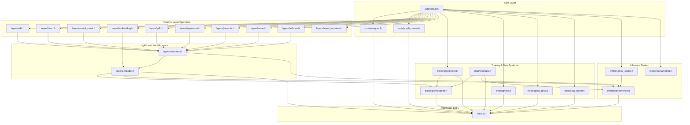

# Architecture & Header Dependency Map
**Project:** Pure C++/CUDA Transformer Engine (TinyStories GPT / ViT Architecture)  
**Location:** `c:\Users\ATHARV\source\repos\CUDA_Engine\CUDA_Engine\ViT`  
**Target Architecture:** NVIDIA Ada Lovelace (RTX 4060 Laptop GPU, Compute Capability 8.9)  
**Build Toolchain:** MSVC 19.39 (`cl.exe`) + NVIDIA CUDA Toolkit 13.3 (`nvcc`) + CMake 3.29.3  

---

## 1. Complete File Inventory

Below is the complete file directory tree of the active codebase, categorizing every header, implementation, and script by functional module.

```
CUDA_Engine/ViT/
├── CMakeLists.txt                 # Master CMake build configuration
├── build.bat                      # Developer compilation script (vcvars64 + NMake)
├── main.cu                        # Application entry point: CLI dispatcher, training & chat loops
│
├── core/                          # Autograd & Memory Runtime Engine
│   ├── tensor.h                   # Core Tensor class, Closure abstractions, stride computation
│   ├── tensor.cpp                 # Tensor constructors, custom CUDA allocators/deleters, print, grad_norm
│   ├── autograd.h                 # Topological sorting and graph traversal triggers
│   ├── autograd.cu                # Backward graph runner, MSE loss, closure execution & cycle breaking
│   ├── graph_runner.h             # CUDA Graph stream capture and replay harness
│   └── graph_runner.cpp           # CUDA Graph lifecycle management (instantiate, launch, destroy)
│
├── layers/                        # Neural Network Operations & CUDA Kernels
│   ├── modules.h                  # High-level OOP modules: Linear, LayerNorm, MultiHeadAttention
│   ├── encoder.h                  # TransformerEncoderBlock and TransformerEncoder class definitions
│   ├── encoder.cu                 # Forward pipeline: Token + Pos Embed -> Residual Blocks -> Final LN
│   ├── add.h                      # Element-wise and broadcast tensor addition declarations
│   ├── add.cu                     # CUDA broadcast addition kernel and backward gradient router
│   ├── bmm.h                      # Batched Matrix Multiplication (BMM) interfaces
│   ├── bmm.cu                     # Tiled shared-memory BMM kernels (GEMM, GEMM-transB, scalar fallback)
│   ├── causal_mask.h              # Autoregressive upper-triangular causal masking interface
│   ├── causal_mask.cu             # In-place causal mask CUDA kernel (-1e9f injection)
│   ├── embedding.h                # Word and learned positional embedding classes
│   ├── embedding.cu               # Integer-indexed embedding forward/backward kernels with atomicAdd
│   ├── layernorm.h                # Layer Normalization declarations
│   ├── layernorm.cu               # Warp-reduced mean/variance LayerNorm forward/backward kernels
│   ├── gelu.h                     # Gaussian Error Linear Unit interface
│   ├── gelu.cu                    # GELU tanh approximation forward and backward gradient kernels
│   ├── softmax.h                  # Numerically stable Softmax interface
│   ├── softmax.cu                 # Safe-Softmax forward and Jacobian backward CUDA kernels
│   ├── permute.h                  # Multi-dimensional tensor transpose and view interfaces
│   ├── permute.cu                 # Generalized coordinate permutation and contiguous copy kernels
│   ├── scale.h                    # Scalar multiplication interface
│   ├── scale.cu                   # Scalar multiplication forward/backward kernels
│   ├── fused_modules.h            # Experimental fused forward operation prototypes
│   └── fused_modules.cu           # Fused Add+GELU and Fused Scale+Softmax kernels
│
├── training/                      # Training Pipeline, Optimization, Loss & Checkpointing
│   ├── loss.h                     # Cross-Entropy loss interface
│   ├── loss.cu                    # Log-Sum-Exp Cross-Entropy forward & backward gradient kernels
│   ├── optimizer.h                # Decoupled AdamW optimizer class definition
│   ├── optimizer.cu               # AdamW CUDA parameter update kernel with decoupled weight decay
│   ├── clip_grad.h                # Global gradient clipping interface
│   ├── clip_grad.cu               # Parallel L2-norm reduction and gradient scaling kernels
│   ├── checkpoint.h               # Binary model serialization and deserialization interface
│   ├── checkpoint.cpp             # Binary checkpoint writer and loader (weights, optimizer state, vocab)
│   └── train_loop.cu              # Standalone prototype trainer (excluded from master CMake target)
│
├── data/                          # Data Ingestion & Tokenization Subsystems
│   ├── tokenizer.h                # Word-level vocabulary tokenizer class definition
│   ├── tokenizer.cpp              # Vocabulary ingestion, encoding, decoding, and vocab saving/loading
│   ├── data_loader.h              # Memory-mapped binary dataset streaming interface
│   ├── data_loader.cu             # Win32 CreateFileMapping, cudaHostRegister, and int32->float casting
│   ├── vocab.txt                  # Preprocessed active vocabulary file (8,192 tokens)
│   └── train_tokens.bin           # Preprocessed binary training dataset (raw 32-bit integer token stream)
│
├── inference/                     # Autoregressive Text Generation & KV-Caching
│   ├── inference.h                # Autoregressive text generation loops and weight transfer helpers
│   ├── inference.cu               # Autoregressive generation loop with temperature and top-p nucleus sampling
│   ├── kv_cache.h                 # Key-Value attention state cache class definition
│   ├── kv_cache.cu                # Pre-allocated rolling KV-cache tensor slicing and appending kernels
│   ├── sampling.h                 # Logit temperature scaling and Top-p nucleus sampling interfaces
│   └── sampling.cu                # Temperature scaling, parallel bitonic sort, and block prefix sum kernels
│
└── tools/                         # Offline Corpus Utilities
    └── preprocess.cpp             # Pass 1 word frequency counter and Pass 2 binary token stream encoder
```

---

## 2. Header & Inclusion Graph

Every file in the repository relies on a strictly hierarchical dependency structure designed to avoid circular header dependencies while preserving clean separation between core data structures, mathematical operations, network layers, and training optimizers.



### Granular Header Breakdown

#### 1. `core/tensor.h`
* **Direct Dependencies:** `<vector>`, `<memory>`, `<stdexcept>`, `<cuda_runtime.h>`.
* **Inclusion Rationale:** Defines the fundamental atomic data type of the entire engine: `struct Tensor`. It provides CUDA memory management abstraction, autograd gradient pointer retention, shape and stride tracking, and the type-erased `ClosurePtr` time-capsule.
* **Declarations & Structs:**
  * `struct IClosure`: Abstract virtual base class for type-erasing autograd backward closures.
  * `template<typename F> struct Closure`: Derived templated wrapper holding lambda state and invoking `operator()()`.
  * `struct Tensor::ClosurePtr`: Smart wrapper holding `std::shared_ptr<IClosure>`, enabling assignment from arbitrary C++ lambdas.
  * `struct Tensor`: Multi-dimensional tensor containing `std::shared_ptr<float> data`, `std::shared_ptr<float> grad`, `std::vector<int> shape`, `std::vector<int> strides`, `std::vector<std::shared_ptr<Tensor>> parents`, and methods `compute_strides()`, `get_offset()`, `fill()`, `print()`, `zero_grad()`, `grad_norm()`.

#### 2. `core/autograd.h`
* **Direct Dependencies:** `../core/tensor.h`, `<memory>`.
* **Inclusion Rationale:** Declares the master DAG backpropagation orchestrator and utility loss functions that build computational graphs.
* **Declarations:**
  * `void backward(std::shared_ptr<Tensor> loss_node);`
  * `std::shared_ptr<Tensor> mse_loss(std::shared_ptr<Tensor> predictions, std::shared_ptr<Tensor> targets);`

#### 3. `core/graph_runner.h`
* **Direct Dependencies:** `<cuda_runtime.h>`.
* **Inclusion Rationale:** Encapsulates the NVIDIA CUDA Graphs API (`cudaStreamBeginCapture`, `cudaStreamEndCapture`, `cudaGraphInstantiate`, `cudaGraphLaunch`), allowing repeated execution of whole computational graphs with zero CPU kernel-launch overhead.
* **Declarations:**
  * `class CUDAGraphRunner`: Contains `cudaGraph_t graph`, `cudaGraphExec_t instance`, `bool is_captured`, templated member `capture(F work, cudaStream_t stream)`, and `execute(cudaStream_t stream)`.

#### 4. `layers/add.h`
* **Direct Dependencies:** `../core/tensor.h`, `<memory>`.
* **Inclusion Rationale:** Defines broadcasting element-wise addition across tensors of arbitrary matching or broadcastable shapes.
* **Declarations:**
  * `std::shared_ptr<Tensor> add(std::shared_ptr<Tensor> A, std::shared_ptr<Tensor> B);`

#### 5. `layers/bmm.h`
* **Direct Dependencies:** `../core/tensor.h`, `<memory>`.
* **Inclusion Rationale:** Declares batched matrix multiplication with optional transposition of matrix $B$ ($A \times B^T$).
* **Declarations:**
  * `std::shared_ptr<Tensor> bmm(std::shared_ptr<Tensor> A, std::shared_ptr<Tensor> B, bool transB = false);`

#### 6. `layers/causal_mask.h`
* **Direct Dependencies:** `../core/tensor.h`, `<memory>`.
* **Inclusion Rationale:** Declares in-place causal mask injection for autoregressive self-attention, overwriting tokens where column index exceeds row index with $-10^9$.
* **Declarations:**
  * `std::shared_ptr<Tensor> apply_causal_mask(std::shared_ptr<Tensor> input);`

#### 7. `layers/embedding.h`
* **Direct Dependencies:** `../core/tensor.h`, `<memory>`, `<vector>`.
* **Inclusion Rationale:** Defines the lookup table module mapping discrete token IDs and sequence step indices to continuous feature vectors.
* **Declarations:**
  * `class Embedding`: Contains `std::shared_ptr<Tensor> weight`, `int vocab_size`, `int embed_dim`, methods `forward()` (float inputs) and `forward_int()` (`int32_t` inputs).
  * `class LearnedPositionalEncoding`: Holds `Embedding pe_embed`, `std::shared_ptr<Tensor> cached_pos_ids`, and method `forward(std::shared_ptr<Tensor> x)`.

#### 8. `layers/gelu.h`
* **Direct Dependencies:** `../core/tensor.h`, `<memory>`.
* **Inclusion Rationale:** Declares the Gaussian Error Linear Unit activation function.
* **Declarations:**
  * `std::shared_ptr<Tensor> gelu(std::shared_ptr<Tensor> input);`

#### 9. `layers/layernorm.h`
* **Direct Dependencies:** `../core/tensor.h`, `<memory>`.
* **Inclusion Rationale:** Declares Layer Normalization across the final dimension of a tensor.
* **Declarations:**
  * `std::shared_ptr<Tensor> layernorm(std::shared_ptr<Tensor> input, std::shared_ptr<Tensor> weight, std::shared_ptr<Tensor> bias, float eps = 1e-5f);`

#### 10. `layers/modules.h`
* **Direct Dependencies:** `../core/tensor.h`, `../layers/add.h`, `../layers/bmm.h`, `../layers/gelu.h`, `../layers/layernorm.h`, `../layers/softmax.h`, `../layers/permute.h`, `../layers/scale.h`, `../layers/causal_mask.h`, `<cmath>`, `<random>`, `<iostream>`.
* **Inclusion Rationale:** Serves as the composite layer header, assembling foundational operators into standard Transformer components.
* **Declarations & Classes:**
  * `class Linear`: Encapsulates weights $W \in \mathbb{R}^{\text{out} \times \text{in}}$ and optional bias $b \in \mathbb{R}^{\text{out}}$, computing $X W^T + b$.
  * `class LayerNorm`: Module wrapper storing learnable scaling $\gamma$ (`weight`) and shift $\beta$ (`bias`).
  * `class MultiHeadAttention`: Full Multi-Head Self-Attention module containing `q_proj`, `k_proj`, `v_proj`, `out_proj`, head splitting, scaling, causal masking, Softmax, and context projection.

#### 11. `layers/encoder.h`
* **Direct Dependencies:** `../layers/modules.h`, `../layers/embedding.h`, `<vector>`, `<memory>`.
* **Inclusion Rationale:** Defines the high-level Transformer Encoder / Decoder architecture stacking multiple residual blocks.
* **Declarations & Classes:**
  * `class TransformerEncoderBlock`: Encapsulates pre-LN attention residual block ($x_1 = x + \text{MHSA}(\text{LN}_1(x))$) and feed-forward residual block ($x_2 = x_1 + \text{MLP}(\text{LN}_2(x_1))$).
  * `class TransformerEncoder`: Top-level model containing `token_embed`, `pos_embed`, `std::vector<std::shared_ptr<TransformerEncoderBlock>> blocks`, and `final_ln`.

#### 12. `training/loss.h`
* **Direct Dependencies:** `../core/tensor.h`, `<memory>`.
* **Inclusion Rationale:** Defines the fused Cross-Entropy loss operator that bypasses materialization of huge intermediate probability matrices.
* **Declarations:**
  * `std::shared_ptr<Tensor> cross_entropy_loss(std::shared_ptr<Tensor> logits, const int* d_targets);`

#### 13. `training/optimizer.h`
* **Direct Dependencies:** `../core/tensor.h`, `<vector>`, `<memory>`.
* **Inclusion Rationale:** Defines the AdamW optimizer state and member functions.
* **Declarations & Classes:**
  * `class AdamW`: Holds learning rate, $\beta_1, \beta_2$, $\epsilon$, decoupled weight decay coefficient, iteration counter $t$, list of registered parameters, and device pointers `std::vector<float*> m_buffers, v_buffers`.

#### 14. `training/clip_grad.h`
* **Direct Dependencies:** `../core/tensor.h`, `<vector>`, `<memory>`.
* **Inclusion Rationale:** Defines global gradient clipping across all parameter tensors to prevent exploding gradients.
* **Declarations:**
  * `void clip_grad_norm(const std::vector<std::shared_ptr<Tensor>>& parameters, float max_norm);`

#### 15. `training/checkpoint.h`
* **Direct Dependencies:** `<string>`, `../layers/encoder.h`, `../training/optimizer.h`, `../data/tokenizer.h`.
* **Inclusion Rationale:** Declares binary persistence mechanisms for model weights, optimizer buffers, and tokenizer vocabulary.
* **Declarations:**
  * `void save_checkpoint(const std::string& filepath, TransformerEncoder& model, AdamW& optimizer, Tokenizer& tokenizer);`
  * `void load_checkpoint(const std::string& filepath, TransformerEncoder& model, AdamW& optimizer, Tokenizer& tokenizer);`

#### 16. `data/tokenizer.h`
* **Direct Dependencies:** `<string>`, `<vector>`, `<unordered_map>`.
* **Inclusion Rationale:** Defines string tokenization, vocabulary mapping, encoding text to token IDs, and decoding IDs back to natural text.
* **Declarations & Classes:**
  * `class Tokenizer`: Contains `token_to_id`, `id_to_token`, `vocab_size`, `encode()`, `decode()`, `load_vocab()`, `save_vocab()`.

#### 17. `data/data_loader.h`
* **Direct Dependencies:** `<string>`, `<vector>`, `<memory>`, `<windows.h>`, `<cuda_runtime.h>`, `../core/tensor.h`.
* **Inclusion Rationale:** Defines the zero-copy, memory-mapped OS streaming pipeline for binary datasets.
* **Declarations & Classes:**
  * `class BinaryDataLoader`: Manages Win32 file mapping handles `hFile`, `hMapping`, pinned memory pointer `mapped_data`, persistent GPU staging buffer `d_batch_ints`, and method `get_next_batch()`.

#### 18. `inference/inference.h`
* **Direct Dependencies:** `../core/tensor.h`, `../layers/modules.h`, `../data/tokenizer.h`, `../layers/encoder.h`, `../inference/kv_cache.h`, `<memory>`, `<string>`.
* **Inclusion Rationale:** Declares the high-level text generation routines and autoregressive KV-cache inference architectures.
* **Declarations:**
  * `class CausalSelfAttention`, `class AutoregressiveTransformerBlock`, `class AutoregressiveModel`.
  * `void run_autoregressive_inference(...)`
  * `void copy_weights_to_inference(...)`

#### 19. `inference/kv_cache.h`
* **Direct Dependencies:** `../core/tensor.h`, `<memory>`.
* **Inclusion Rationale:** Defines key and value history retention across sequence generation steps to achieve $O(1)$ decoding compute per token.
* **Declarations & Classes:**
  * `class KVCache`: Contains `k_cache`, `v_cache`, sequence bounds, `append()`, `get_k_view()`, `get_v_view()`, `reset()`.

#### 20. `inference/sampling.h`
* **Direct Dependencies:** `../core/tensor.h`, `<memory>`.
* **Inclusion Rationale:** Defines temperature scaling and Top-$p$ nucleus distribution filtering.
* **Declarations:**
  * `struct ProbIndex`: Holds `{ float prob; int index; }`.
  * `void temperature_scale(std::shared_ptr<Tensor> logits, float temperature);`
  * `int top_p_sample(std::shared_ptr<Tensor> logits, float p, float rand_val);`

---

## 3. Compilation Workflow & Compiler Toolchain

The build process transforms a mixed repository of standard C++17 source files (`.cpp`) and CUDA device files (`.cu`) into a single high-performance executable (`cuda_engine.exe`).

### 1. The Build Script (`build.bat`)

```bat
@echo off
call "C:\Program Files\Microsoft Visual Studio\18\Community\VC\Auxiliary\Build\vcvars64.bat" -vcvars_ver=14.39

set "CMAKE_EXE=%~dp0cmake\cmake-3.29.3-windows-x86_64\bin\cmake.exe"

if exist build rmdir /s /q build

echo Generating build files...
"%CMAKE_EXE%" -G "NMake Makefiles" -B build

echo Compiling CUDA Engine in Release mode...
"%CMAKE_EXE%" --build build --config Release

echo ----------------------------------------------------
echo Build complete. Executable is located at:
echo .\build\cuda_engine.exe
echo ----------------------------------------------------
```

### 2. Interaction Between MSVC (`cl.exe`) and NVIDIA `nvcc`

CUDA compilation requires a split-compiler pipeline:
1. **Environment Initialization (`vcvars64.bat`)**:
   - `vcvars64.bat` configures the 64-bit host compilation environment: it adds `cl.exe` (Microsoft C/C++ Optimizing Compiler), `link.exe`, Windows SDK header include directories, and system runtime libraries (`kernel32.lib`, `user32.lib`, etc.) to the system `PATH` and `INCLUDE` environment variables.
2. **CMake Generator (`NMake Makefiles`)**:
   - CMake detects `cl.exe` as the host CXX compiler and `nvcc.exe` as the CUDA compiler.
   - It generates an `NMake` build script instructing how each translation unit is compiled and linked.
3. **Compilation of `.cpp` Files**:
   - `cl.exe` directly compiles pure C++ translation units (`core/tensor.cpp`, `core/graph_runner.cpp`, `data/tokenizer.cpp`, `training/checkpoint.cpp`) with optimization flag `/O2` and C++17 compliance (`/std:c++17`).
4. **Compilation of `.cu` Files by `nvcc`**:
   - For every `.cu` file, `nvcc` acts as a compiler driver.
   - **Host Code Extraction**: `nvcc` extracts host-side code (operator wrapper functions, autograd lambda definitions, `cudaMalloc` calls) and passes it to `cl.exe`.
   - **Device Code Compilation**: `nvcc` translates CUDA device kernels (`__global__`, `__device__`) into NVIDIA PTX (Parallel Thread Execution) intermediate assembly, then compiles it into SASS machine code targeting the GPU architecture (`sm_89` on RTX 4060).
   - In our build flags (`CMakeLists.txt`):
     ```cmake
     set(CMAKE_CUDA_FLAGS "${CMAKE_CUDA_FLAGS} --default-stream per-thread -w")
     ```
     `--default-stream per-thread` replaces the legacy implicit synchronization of the default stream (`stream 0`) with independent per-thread streams, enabling concurrent kernel execution and asynchronous memory copies.
5. **CUDA Separable Compilation & Device Linking**:
   - In `CMakeLists.txt`, we explicitly configure:
     ```cmake
     set_target_properties(cuda_engine PROPERTIES CUDA_SEPARABLE_COMPILATION ON)
     ```
   - Standard CUDA compilation compiles device code into monolithic object files. However, when kernels call `__device__` helper functions across different translation units (such as shared reduction primitives or `__shfl_down_sync`), **Device Linking** is mandatory.
   - `nvcc` performs an intermediate device-link phase:
     ```
     nvcc --device-link CMakeFiles/cuda_engine.dir/*.obj -o cmake_device_link.obj
     ```
   - This resolves cross-file device function calls into a consolidated device link object (`cmake_device_link.obj`).
6. **Final Executable Linkage**:
   - `link.exe` binds together:
     * Host object files (`tensor.cpp.obj`, `tokenizer.cpp.obj`, `checkpoint.cpp.obj`, `graph_runner.cpp.obj`)
     * CUDA host/device objects (`main.cu.obj`, `bmm.cu.obj`, `layernorm.cu.obj`, etc.)
     * Device link object (`cmake_device_link.obj`)
     * NVIDIA runtime libraries (`cudadevrt.lib`, `cudart.lib`)
     * Windows Win32 API libraries (`kernel32.lib`, `user32.lib`, `advapi32.lib`)
   - The result is the finalized binary: `build\cuda_engine.exe`.
