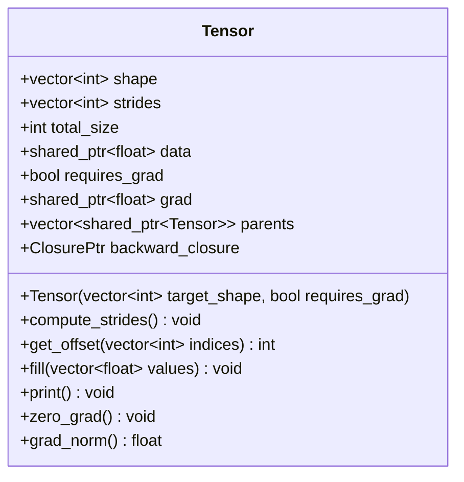

# C++ Memory Model & Host-Device Execution Workflow
**Project:** Pure C++/CUDA Transformer Engine  
**Module:** Core Autograd & Memory Runtime  
**Key Sources:** `core/tensor.h`, `core/tensor.cpp`, `core/autograd.h`, `core/autograd.cu`  

---

## 1. Advanced C++ Language Mechanics in the Engine

The engine is engineered in modern C++17, avoiding third-party runtime frameworks (such as PyTorch, LibTorch, or ONNX Runtime). To achieve both zero-overhead hardware execution and expressive high-level modularity, the codebase relies on several advanced C++ language mechanisms.

### 1. `std::shared_ptr` with Custom Asynchronous Deleters
In standard deep learning frameworks, tensor memory must be managed across complex, dynamically branching computational graphs. If a tensor is deleted while an active autograd closure still requires it, the process crashes with a segmentation fault. Conversely, manual memory management (`malloc` / `free`) across branching DAGs inevitably causes severe memory leaks.

The engine uses `std::shared_ptr<float>` to manage GPU pointers, but pairs it with **custom asynchronous CUDA deleters**:

```cpp
// core/tensor.cpp: Lines 34-36
data = shared_ptr<float>(raw_device_ptr, [](float* ptr) {
    if (ptr != nullptr) cudaFreeAsync(ptr, cudaStreamPerThread);
});
```

#### Why Custom Deleters?
1. **Decoupled Lifetime Management**: The C++ host object `Tensor` does not manually track which downstream operators still need its memory. When every `std::shared_ptr<Tensor>` referring to a buffer goes out of scope, the reference counter decrements to zero, and the custom lambda deleter automatically dispatches `cudaFreeAsync`.
2. **Asynchronous Stream Coordination**: Standard `cudaFree` is an aggressive host-synchronizing call that stalls the CPU and flushes the entire GPU pipeline. By utilizing `cudaFreeAsync(ptr, cudaStreamPerThread)`, deallocation is enqueued as an asynchronous task on the thread's active stream. The GPU reclaims VRAM only after prior compute kernels finish accessing it, without causing CPU stalls.

---

### 2. Custom Type-Erased Closures (`IClosure`, `Closure<F>`, `ClosurePtr`)
In deep learning backpropagation, each forward operator must package a "time capsule" (a backward closure) containing the upstream gradient routing logic. While `std::function<void()>` is standard C++, it suffers from significant heap allocation overhead and opaque internal lifetime semantics when capturing complex lambdas.

Our engine implements custom lightweight type-erasure:

```cpp
// core/tensor.h: Lines 10-12
struct IClosure { 
    virtual void operator()() = 0; 
    virtual ~IClosure() = default; 
};

template<typename F> 
struct Closure : public IClosure { 
    F f; 
    Closure(F f) : f(f) {} 
    void operator()() override { f(); } 
};
```

And integrates it into the `Tensor` struct via a custom handle:

```cpp
// core/tensor.h: Line 29
struct ClosurePtr { 
    std::shared_ptr<IClosure> ptr; 
    
    template<typename F> 
    ClosurePtr& operator=(F f) { 
        ptr = std::make_shared<Closure<F>>(f); 
        return *this; 
    } 
    
    operator bool() const { return ptr != nullptr; } 
    void operator()() { if (ptr) (*ptr)(); } 
};
ClosurePtr backward_closure;
```

#### Why Custom Type-Erasure?
- **Zero SFINAE Boilerplate**: Any C++ lambda can be assigned directly to `out->backward_closure = [...]() { ... };`.
- **Deterministic Pointer Annihilation**: Because `ClosurePtr` wraps an explicit `std::shared_ptr<IClosure> ptr`, the backward runner can explicitly destroy the lambda and all its captured environments by executing:
  ```cpp
  node->backward_closure.ptr = nullptr;
  ```
  This immediately severs captured variables and eliminates memory leaks.

---

### 3. `std::unordered_set` for $O(1)$ Memory Address Deduplication
Deep neural networks with weight tying (such as GPT architectures where the Language Model Head shares weights with the Token Embedding table) present a major hazard: if the same physical weight tensor is visited twice during optimization or graph traversal, it can lead to CUDA race conditions or infinite recursion.

The engine uses `std::unordered_set<void*>` hashing raw memory addresses:
- **Parameter Collection (`main.cu`)**:
  ```cpp
  std::unordered_set<void*> seen;
  auto add_param = [&](std::shared_ptr<Tensor> p) {
      if (p && seen.find(p->data.get()) == seen.end()) {
          seen.insert(p->data.get());
          params.push_back(p);
      }
  };
  ```
- **Topological Sorting (`core/autograd.cu`)**:
  ```cpp
  std::unordered_set<Tensor*> visited;
  build_topo(loss_node, visited, topo);
  ```
Hashing pointer values (`p->data.get()` or `node.get()`) guarantees $O(1)$ duplicate elimination with zero performance penalty.

---

### 4. C++ Lambda Capture Mechanics: `std::weak_ptr` vs `std::shared_ptr`
When constructing closures inside forward operators, how variables are captured is critical:

| Capture Mode | Syntax | Semantic Consequence | Risk in Autograd Engine |
| :--- | :--- | :--- | :--- |
| **Capture by Value (shared_ptr)** | `[out]() { ... }` | Increments `out.use_count()` by 1. Lambda holds strong reference. | **Fatal Circular Reference**: `out` owns closure; closure holds `out`. Leak! |
| **Capture by Weak Pointer** | `[weak_out = std::weak_ptr(out)]() { auto out = weak_out.lock(); ... }` | Does NOT increment `use_count()`. Allows object deletion when graph falls out of scope. | **Safe**: No cyclic dependency. Temporary lock during backward execution only. |
| **Capture Raw Pointers** | `[d_ptr = out->data.get()]() { ... }` | Zero reference count tracking. Pointer must remain valid until closure executes. | Safe only if parent graph tensors are guaranteed alive by `parents` vector. |

---

## 2. The Tensor Anatomy

The `Tensor` struct (`core/tensor.h`) is the primary data structure of the engine. It encapsulates multi-dimensional shape coordinates, host metadata, physical device VRAM allocations, and the autograd computational graph.



### Granular Field Breakdown

```cpp
// core/tensor.h: Lines 18-30
struct Tensor {
    // 1. Structural Metadata (Lives in Host CPU RAM)
    vector<int> shape;                  // e.g. {16, 128, 256}
    vector<int> strides;                // e.g. {32768, 256, 1}
    int total_size;                     // Total float count = 16 * 128 * 256 = 524,288

    // 2. Mathematical State (Device VRAM via Smart Pointers)
    shared_ptr<float> data;             // Primary forward buffer on GPU

    // 3. Autograd State
    bool requires_grad;                 // Gradient tracking flag
    shared_ptr<float> grad;             // Accumulation gradient buffer on GPU
    vector<shared_ptr<Tensor>> parents; // Directed DAG links to upstream operands
    ClosurePtr backward_closure;        // Type-erased backward kernel launch lambda
};
```

1. `shape`: A dynamic `std::vector<int>` recording dimensional extents. For example:
   - 1D Bias: `[256]`
   - 2D Weights: `[256, 256]` (stored as `[Out, In]` for $X W^T$ multiplication)
   - 3D Activations: `[16, 128, 256]` ($[B, S, D]$)
   - 4D Attention Scores: `[16, 8, 128, 128]` ($[B, H, S, S]$)
2. `strides`: Defines row-major memory jumps. In standard row-major layout:
   $$\text{strides}[i] = \prod_{k=i+1}^{N-1} \text{shape}[k], \quad \text{strides}[N-1] = 1$$
3. `total_size`: The scalar product of all dimensions $\prod_{i} \text{shape}[i]$, representing the exact number of 32-bit floats allocated.
4. `data`: A `std::shared_ptr<float>` holding the raw GPU device memory address allocated via `cudaMallocAsync`.
5. `requires_grad`: If `true`, the constructor allocates an identical `grad` buffer and instructs forward operators to register parent relationships and backward closures.
6. `grad`: A `std::shared_ptr<float>` holding accumulated partial derivatives $\frac{\partial \mathcal{L}}{\partial x}$. Initialized strictly to zero via `cudaMemset`.
7. `parents`: A collection of `std::shared_ptr<Tensor>` pointing to the inputs that produced this tensor. This keeps operand tensors alive in host memory until the backward pass traverses them.
8. `backward_closure`: The executable functor storing the backward CUDA kernel launch parameters and captured variables.

---

### Method Implementations (`core/tensor.cpp`)

#### 1. Constructor
```cpp
// core/tensor.cpp: Lines 8-62
Tensor::Tensor(const vector<int>& target_shape, bool req_grad) {
    shape = target_shape;
    requires_grad = req_grad;

    if (shape.empty()) {
        total_size = 0;
        data = nullptr;
        grad = nullptr;
        return;
    }

    total_size = 1;
    for (int dim : shape) {
        if (dim <= 0) throw invalid_argument("Dimensions must be greater than zero.");
        total_size *= dim;
    }

    // 1. Allocate VRAM for Mathematical Data
    float* raw_device_ptr = nullptr;
    cudaError_t err = cudaMallocAsync((void**)&raw_device_ptr, total_size * sizeof(float), cudaStreamPerThread);
    if (err != cudaSuccess) throw runtime_error("CUDA Malloc failed for data: " + string(cudaGetErrorString(err)));

    data = shared_ptr<float>(raw_device_ptr, [](float* ptr) {
        if (ptr != nullptr) cudaFreeAsync(ptr, cudaStreamPerThread);
    });
    cudaMemsetAsync(data.get(), 0, total_size * sizeof(float), cudaStreamPerThread);

    // 2. Allocate VRAM for Gradients (If requested)
    if (requires_grad) {
        float* raw_grad_ptr = nullptr;
        err = cudaMallocAsync((void**)&raw_grad_ptr, total_size * sizeof(float), cudaStreamPerThread);
        if (err != cudaSuccess) throw runtime_error("CUDA Malloc failed for grad: " + string(cudaGetErrorString(err)));

        grad = shared_ptr<float>(raw_grad_ptr, [](float* ptr) {
            if (ptr != nullptr) cudaFreeAsync(ptr, cudaStreamPerThread);
        });
        cudaMemset(grad.get(), 0, total_size * sizeof(float));
    } else {
        grad = nullptr;
    }

    backward_closure = []() {};
    compute_strides();
}
```

#### 2. `compute_strides()`
```cpp
// core/tensor.cpp: Lines 64-72
void Tensor::compute_strides() {
    if (shape.empty()) return;
    strides.resize(shape.size());

    strides.back() = 1;
    for (int i = (int)shape.size() - 2; i >= 0; --i) {
        strides[i] = strides[i + 1] * shape[i + 1];
    }
}
```
Traverses dimensions in reverse order, calculating cumulative multiplication of trailing dimensions.

#### 3. `get_offset()`
```cpp
// core/tensor.cpp: Lines 74-87
int Tensor::get_offset(const vector<int>& indices) const {
    if (indices.size() != shape.size()) {
        throw invalid_argument("Error: Number of indices does not match tensor dimensions.");
    }
    int offset = 0;
    for (size_t i = 0; i < indices.size(); ++i) {
        if (indices[i] < 0 || indices[i] >= shape[i]) {
            throw out_of_range("Error: Index out of bounds at dimension " + to_string(i));
        }
        offset += indices[i] * strides[i];
    }
    return offset;
}
```
Converts multidimensional coordinates $(i_0, i_1, \dots, i_{k-1})$ into a 1D flat memory index:
$$\text{offset} = \sum_{j=0}^{k-1} i_j \cdot \text{strides}[j]$$

#### 4. `zero_grad()`
```cpp
// core/tensor.cpp: Lines 129-134
void Tensor::zero_grad() {
    if (requires_grad && grad != nullptr) {
        cudaMemsetAsync(grad.get(), 0, total_size * sizeof(float), 0);
    }
}
```
Clears accumulated gradients back to zero using non-blocking asynchronous memset on the active stream.

#### 5. `grad_norm()`
```cpp
// core/tensor.cpp: Lines 138-145
float Tensor::grad_norm() {
    if (!requires_grad || !grad) return 0.0f;
    std::vector<float> h_grad(total_size);
    cudaMemcpy(h_grad.data(), grad.get(), total_size * sizeof(float), cudaMemcpyDeviceToHost);
    float sum_sq = 0.0f;
    for (float g : h_grad) sum_sq += g * g;
    return std::sqrt(sum_sq);
}
```
Computes the Euclidean $L_2$ norm $\|g\|_2 = \sqrt{\sum_i g_i^2}$ for monitoring gradient stability and detecting exploding/vanishing gradients.

---

## 3. Host (CPU) vs. Device (GPU) Execution Map

Understanding the hardware boundary between host system RAM and device VRAM is critical for high-throughput CUDA programming.

```mermaid
flowchart TD
    subgraph Host System RAM (CPU)
        T_OBJ["Tensor Metadata<br/>(shape, strides, total_size, parents)"]
        CLOSURE["Backward Closures<br/>(Captured Weak Pointers, Kernel Launch Config)"]
        PINNED["Pinned Host Memory<br/>(BinaryDataLoader mapped_data via cudaHostRegister)"]
        HOST_VEC["std::vector&lt;float&gt; Temporary Host Buffers"]
    end

    subgraph PCIe Gen4 Bus
        DMA_UP["cudaMemcpyAsync (Pinned Host -> VRAM)"]
        DMA_DOWN["cudaMemcpy (Device -> Host Diagnostics)"]
    end

    subgraph Device VRAM (GPU - RTX 4060)
        D_BUF["tensor->data (FP32 Activations / Weights)"]
        G_BUF["tensor->grad (FP32 Gradients)"]
        OPT_M["optimizer->m_buffers (AdamW 1st Moment)"]
        OPT_V["optimizer->v_buffers (AdamW 2nd Moment)"]
        STAGING["d_batch_ints (DataLoader Intermediate Buffer)"]
    end

    T_OBJ -.->|Manages Pointers| D_BUF
    T_OBJ -.->|Manages Pointers| G_BUF
    PINNED -->|DMA Async Stream| DMA_UP
    DMA_UP --> STAGING
    G_BUF -->|Diagnostics| DMA_DOWN
    DMA_DOWN --> HOST_VEC
```

### Precise Lifecycle Allocation Tracing

| Operation | Execution Target | API Triggered | Memory Space | Lifecycle / Destruction |
| :--- | :--- | :--- | :--- | :--- |
| **Tensor Instantiation** | CPU Host | `cudaMallocAsync` | GPU VRAM | Allocated in stream; freed via custom deleter when ref count = 0 |
| **Gradient Initialization** | CPU Host | `cudaMemsetAsync` | GPU VRAM | Initialized to $0.0f$; cleared every training step by `zero_grad()` |
| **DataLoader Open** | CPU Host | `CreateFileMapping` + `MapViewOfFile` | Host Virtual Memory | Unmapped in `~BinaryDataLoader()` via `UnmapViewOfFile` |
| **Memory Pinning** | Host / GPU Driver | `cudaHostRegister` | Host Physical RAM | Locks virtual pages into RAM; unregistered in destructor |
| **Batch Streaming** | GPU DMA Engine | `cudaMemcpyAsync` | PCIe Bus | Asynchronous transfer from pinned host memory to `d_batch_ints` |
| **Weight Initialization** | CPU Host | `cudaMemcpy(H2D)` | Host $\to$ VRAM | `weight->fill(init_w)` copies normal distribution values to GPU |
| **Loss Readback** | CPU Host | `cudaMemcpy(D2H)` | VRAM $\to$ Host | Synchronous readback of single scalar float for NaN trap |
| **Optimizer Step** | GPU SMs | `adamw_kernel<<<>>>` | GPU VRAM | In-place update: reads `grad`, updates `m`, `v`, and modifies `data` |
| **Graph Destruction** | CPU Host | `tensor.reset()` | Host RAM & VRAM | Decrements shared pointer count; enqueues `cudaFreeAsync` |

---

## 4. The Autograd DAG & Reference Cycle Destruction

The engine implements dynamic reverse-mode automatic differentiation (Autograd). 

### How the DAG is Built Dynamically
During the forward pass, every mathematical operator registers its upstream dependencies and stores its reverse execution derivative inside the output tensor.

Take `add(A, B)` as an example:
```cpp
// layers/add.cu: Lines 92-125
std::shared_ptr<Tensor> add(std::shared_ptr<Tensor> A, std::shared_ptr<Tensor> B) {
    ...
    auto out = std::make_shared<Tensor>(out_shape, out_requires_grad);
    broadcast_add_forward_kernel<<<blocks, threads>>>(A->data.get(), B->data.get(), out->data.get(), info, total_size);

    if (out_requires_grad) {
        // 1. Build DAG edges
        out->parents.push_back(A);
        out->parents.push_back(B);

        // 2. Capture weak pointer to avoid cyclic reference
        std::weak_ptr<Tensor> weak_out = out;
        
        // 3. Encapsulate backward closure
        out->backward_closure = [A, B, info, total_size, blocks, threads, req_a, req_b, weak_out]() {
            auto out = weak_out.lock();
            broadcast_add_backward_kernel<<<blocks, threads>>>(
                A->grad.get(), B->grad.get(), out->grad.get(), info, total_size, req_a, req_b
            );
        };
    }
    return out;
}
```

```mermaid
graph TD
    A[Tensor A: Input] -->|Parent Edge| ADD[Tensor C: Output of Add]
    B[Tensor B: Bias] -->|Parent Edge| ADD
    ADD -->|Parent Edge| GELU[Tensor D: Output of GELU]
    GELU -->|Parent Edge| LOSS[Tensor Loss: Scalar]

    subgraph Backward Sweep (Reverse Topological Order)
        LOSS -.->|1. Seed grad = 1.0| GELU
        GELU -.->|2. gelu_backward_kernel| ADD
        ADD -.->|3. broadcast_add_backward_kernel| A
        ADD -.->|3. broadcast_add_backward_kernel| B
    end
```

### Reverse Topological Sort (`core/autograd.cu`)

When `backward(loss)` is invoked:
1. `build_topo()` performs a post-order depth-first traversal of the computational graph:
   ```cpp
   // core/autograd.cu: Lines 96-109
   void build_topo(std::shared_ptr<Tensor> node, std::unordered_set<Tensor*>& visited, std::vector<std::shared_ptr<Tensor>>& topo) {
       if (visited.find(node.get()) == visited.end()) {
           visited.insert(node.get());
           for (auto& parent : node->parents) {
               build_topo(parent, visited, topo);
           }
           topo.push_back(node);
       }
   }
   ```
2. The initial seed gradient of the loss is set to $1.0f$ ($\frac{\partial \mathcal{L}}{\partial \mathcal{L}} = 1$):
   ```cpp
   seed_gradient_kernel<<<blocks, threads>>>(loss_node->grad.get(), loss_node->total_size);
   ```
3. The traversal iterates through `topo` in **reverse order** (`rbegin()` to `rend()`), executing each node's backward closure.

---

### The 29.4 GB RAM Black Hole & Cycle Destruction

During long training runs, early versions of the engine consumed all available host RAM (29.4 GB), freezing the host machine.

#### The Root Cause: Strong Reference Cycles
In C++, a lambda closure that captures a `std::shared_ptr<T>` by value increments the internal reference count of `T`.

```
[Tensor out] owns -> [Closure backward_closure]
      ^                                |
      |                                v
      +--- captures by value (out) ----+
```

1. `out` holds `backward_closure` inside its struct definition.
2. `backward_closure` captured `out` by value (`[out]() { ... out->grad.get() ... }`).
3. This established a **hard circular reference**: `out`'s reference count could never drop below 1, even after `loss.reset()`, `logits.reset()`, and all local scope pointers fell out of scope.
4. Over thousands of iterations, every intermediate tensor, activation tensor, and autograd closure created across every training step remained locked in RAM. Once physical RAM was exhausted, Windows engaged pagefile disk-thrashing, collapsing throughput to 0% GPU.

#### The Two-Part Structural Resolution

1. **Weak Pointers in Closures**:
   Every closure was updated to capture `std::weak_ptr<Tensor> weak_out = out;`. A weak pointer observes the object without incrementing its reference counter. Inside the closure body, `weak_out.lock()` temporarily promotes it to a shared pointer for kernel dispatch:
   ```cpp
   std::weak_ptr<Tensor> weak_out = out;
   out->backward_closure = [..., weak_out]() {
       auto out = weak_out.lock();
       if (!out) return;
       // Execute CUDA backward kernel...
   };
   ```

2. **Explicit Closure and Edge Destruction in `backward()`**:
   Immediately after each closure executes during the backward sweep, we explicitly destroy the lambda and clear the parent links:
   ```cpp
   // core/autograd.cu: Lines 129-137
   for (auto it = topo.rbegin(); it != topo.rend(); ++it) {
       if ((*it)->backward_closure) {
           (*it)->backward_closure();
           
           // CRITICAL: Explicitly destroy the lambda and captured references
           (*it)->backward_closure.ptr = nullptr;
       }
       // CRITICAL: Break circular/graph references to parent tensors
       (*it)->parents.clear();
   }
   ```

By nullifying `.ptr` and clearing `parents`, every intermediate tensor's reference count immediately drops to 0 at the end of the backward sweep. The C++ runtime reclaims the host memory, and `cudaFreeAsync` instantly frees intermediate GPU activations. System host RAM remains flat at **~150 MB** indefinitely.
