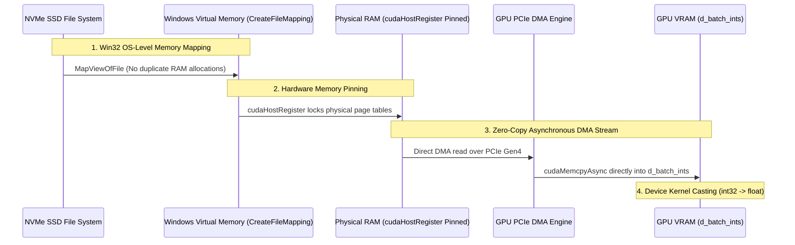

# Data Pipeline, Tokenization & Embeddings
**Project:** Pure C++/CUDA Transformer Engine  
**Module:** Data Ingestion, Tokenization & Embedding Subsystems  
**Key Sources:** `data/tokenizer.h`, `data/tokenizer.cpp`, `tools/preprocess.cpp`, `data/data_loader.h`, `data/data_loader.cu`, `layers/embedding.h`, `layers/embedding.cu`, `main.cu`  

---

## 1. Vocabulary & Tokenization Subsystems

The transformer engine operates on discrete token sequences drawn from the **TinyStories V2** corpus. Text processing occurs in two distinct environments:
1. **Offline Preprocessing (`tools/preprocess.cpp`)**: Consumes raw natural text (`TinyStories_train.txt`), builds a frequency-ranked vocabulary, and compiles the entire corpus into a binary token stream (`train_tokens.bin`).
2. **Online Runtime (`data/tokenizer.cpp`)**: Ingests `vocab.txt` into memory for prompt encoding and token decoding during inference.

```mermaid
flowchart TD
    subgraph Offline Corpus Processing (tools/preprocess.cpp)
        RAW["TinyStories_train.txt<br/>(2.2 GB Raw Text)"] --> PASS1["Pass 1: Word Frequency Counting<br/>(std::unordered_map&lt;string, uint64_t&gt;)"]
        PASS1 --> SORT["Frequency Sorting & Truncation<br/>(Top 8,192 words)"]
        SORT --> VOCAB["data/vocab.txt<br/>(8,192 Token Vocabulary)"]
        RAW --> PASS2["Pass 2: Tokenization Stream<br/>(Chunked buffering: 1,000,000 tokens)"]
        VOCAB --> PASS2
        PASS2 --> BIN["data/train_tokens.bin<br/>(Raw 32-bit Integer Stream)"]
    end

    subgraph Online Engine Execution
        VOCAB --> TOK_INIT["Tokenizer::load_vocab()"]
        BIN --> MAPPING["BinaryDataLoader<br/>(Windows Memory Mapping + Pinning)"]
    end
```

---

### Special Tokens
The tokenizer reserves the first 4 indices ($0 \dots 3$) for critical control tokens:
* `id = 0`: `<pad>` — Padding token used to pad variable-length sequences or represent null targets.
* `id = 1`: `<unk>` — Out-of-vocabulary unknown word fallback.
* `id = 2`: `<bos>` — Beginning-of-sequence delimiter prepended to prompts.
* `id = 3`: `<eos>` — End-of-sequence delimiter terminating generation.

### The Tokenizer Class (`data/tokenizer.cpp`)

```cpp
// data/tokenizer.cpp: Lines 5-10
Tokenizer::Tokenizer() {
    add_token("<pad>"); // 0
    add_token("<unk>"); // 1
    add_token("<bos>"); // 2
    add_token("<eos>"); // 3
}
```

#### Dual Hash-Map Architecture
The tokenizer maintains bidirectional $O(1)$ lookups via two synchronized hash maps:
```cpp
std::unordered_map<std::string, int> token_to_id;
std::unordered_map<int, std::string> id_to_token;
int vocab_size;
```

#### Ingestion & Persistence (`load_vocab` / `save_vocab`)
```cpp
// data/tokenizer.cpp: Lines 21-32
bool Tokenizer::load_vocab(const std::string& vocab_path) {
    std::ifstream infile(vocab_path);
    if (!infile.is_open()) return false;
    std::string line;
    while (std::getline(infile, line)) {
        if (!line.empty()) {
            add_token(line);
        }
    }
    return true;
}
```
`load_vocab` reads `vocab.txt` line by line. Since the file was written in ascending order of token IDs, sequential insertion with `add_token()` reconstructs the original identifier mapping.

#### String Encoding
```cpp
// data/tokenizer.cpp: Lines 45-65
std::vector<int> Tokenizer::encode(const std::string& text, bool update_vocab) {
    std::vector<int> ids;
    ids.push_back(token_to_id["<bos>"]);
    
    std::stringstream ss(text);
    std::string word;
    while (ss >> word) {
        if (token_to_id.find(word) != token_to_id.end()) {
            ids.push_back(token_to_id[word]);
        } else {
            if (update_vocab) {
                add_token(word);
                ids.push_back(token_to_id[word]);
            } else {
                ids.push_back(token_to_id["<unk>"]); // Fallback to unknown token
            }
        }
    }
    ids.push_back(token_to_id["<eos>"]);
    return ids;
}
```
Words separated by whitespace are extracted using `std::stringstream`. If a token exists in `token_to_id`, its integer ID is appended; otherwise, it falls back to `<unk>` (`1`). The output vector is automatically bracketed with `<bos>` (`2`) and `<eos>` (`3`).

#### Integer Decoding
```cpp
// data/tokenizer.cpp: Lines 67-77
std::string Tokenizer::decode(const std::vector<int>& ids) {
    std::string text = "";
    for (int i = 0; i < ids.size(); ++i) {
        if (id_to_token.find(ids[i]) != id_to_token.end()) {
            if (ids[i] >= 4) { // Don't print special control tokens
                text += id_to_token[ids[i]] + (i == ids.size() - 1 ? "" : " ");
            }
        }
    }
    return text;
}
```
Maps integers back to strings, automatically suppressing raw `<pad>`, `<unk>`, `<bos>`, and `<eos>` tags.

---

### Corpus Preprocessor (`tools/preprocess.cpp`)
For maximum throughput, raw text files are never tokenized on-the-fly during training. Instead, `tools/preprocess.cpp` compiles the corpus using a two-pass algorithm:

* **Pass 1: Word Frequency Counting**:
  - Reads `TinyStories_train.txt` in streaming chunks.
  - Builds an `std::unordered_map<std::string, uint64_t> word_freqs`.
  - Sorts unique tokens in descending order of frequency.
  - Selects the top $8,192 - 4 = 8,188$ most frequent words and appends them after the 4 special tokens, saving to `data/vocab.txt`.
* **Pass 2: Binary Stream Generation**:
  - Re-opens `TinyStories_train.txt`.
  - Encodes each line with `tokenizer.encode(line, false)`.
  - Buffers tokens in an in-memory array (`CHUNK_SIZE_TOKENS = 1,000,000`).
  - Flushes chunks sequentially to `data/train_tokens.bin` as raw, unpadded `int32_t` integers.

The compiled dataset occupies $\approx 1.2$ GB on disk, ready for zero-copy streaming.

---

## 2. Zero-Copy Binary Dataset Loader (`data/data_loader.cu`)

Standard dataset loaders in Python or naive C++ read batches from disk into `std::vector` in system RAM, then call `cudaMemcpy` to move them to the GPU. This approach introduces two severe hardware bottlenecks:
1. **CPU Memory Duplication**: Buffering hundreds of gigabytes into RAM causes aggressive OS caching and memory bloat.
2. **PCIe Bus Serialization via Pageable Memory**: Standard host allocations (`malloc` or `new`) allocate **pageable** memory. The GPU DMA (Direct Memory Access) controller cannot safely read pageable memory because the Windows kernel can relocate or swap pages to disk at any instant. Consequently, the CUDA driver must first copy the data synchronously into an internal pinned "staging buffer" before initiating DMA transfer to the GPU, cutting transfer bandwidth in half and stalling the CPU.



### Implementation Mechanics (`data/data_loader.cu`)

```cpp
// data/data_loader.cu: Lines 13-57
BinaryDataLoader::BinaryDataLoader(const std::string& filename, int max_batch_size, int max_seq_len) 
    : current_offset(0) {
    
    max_capacity = max_batch_size * max_seq_len;
    
    // Allocate persistent GPU buffer to avoid malloc overhead during streaming
    cudaError_t err = cudaMalloc(&d_batch_ints, max_capacity * sizeof(int32_t));
    if (err != cudaSuccess) throw std::runtime_error("Failed to allocate GPU buffer for DataLoader.");

    // 1. Open the file mapping via Windows API
    hFile = CreateFileA(filename.c_str(), GENERIC_READ, FILE_SHARE_READ, NULL, OPEN_EXISTING, FILE_ATTRIBUTE_NORMAL, NULL);
    if (hFile == INVALID_HANDLE_VALUE) throw std::runtime_error("Failed to open binary dataset file: " + filename);

    // 2. Determine file bounds
    LARGE_INTEGER size;
    GetFileSizeEx(hFile, &size);
    file_size = size.QuadPart;
    total_tokens = file_size / sizeof(int32_t);

    // 3. Create standard file mapping object
    hMapping = CreateFileMappingA(hFile, NULL, PAGE_READONLY, 0, 0, NULL);
    if (hMapping == NULL) {
        CloseHandle(hFile);
        throw std::runtime_error("Failed to create file mapping.");
    }

    // 4. Map the entire view into the application's virtual address space
    mapped_data = (int32_t*)MapViewOfFile(hMapping, FILE_MAP_READ, 0, 0, 0);
    if (mapped_data == NULL) {
        CloseHandle(hMapping);
        CloseHandle(hFile);
        throw std::runtime_error("Failed to map view of file.");
    }

    // 5. Pin the virtual memory! This is the core optimization for zero-copy streaming.
    err = cudaHostRegister(mapped_data, file_size, cudaHostRegisterReadOnly);
    if (err != cudaSuccess) {
        std::cerr << "Warning: cudaHostRegister failed (code " << err << "). Transfers will fall back to slow pageable memory." << std::endl;
    }
}
```

#### Step-by-Step System Calls:
1. `CreateFileA` & `CreateFileMappingA`: The OS creates a file mapping object backed directly by the filesystem cache. No RAM is allocated yet.
2. `MapViewOfFile`: Maps the entire binary dataset into the process's 64-bit virtual address space. The file is accessed as a standard C++ array pointer (`int32_t* mapped_data`). The Windows virtual memory manager pages in data on-demand straight from NVMe storage.
3. `cudaHostRegister`: **Locks the physical memory pages** underlying `mapped_data`. It registers the memory with the NVIDIA GPU driver, guaranteeing that the operating system will not swap or move these pages.
4. **Hardware DMA Acceleration**: Because the pages are pinned, the GPU's copy engine can read directly from host RAM over the PCIe bus via DMA at PCIe Gen4 line rates ($\approx 26\text{ GB/s}$), completely bypassing the host CPU.

---

### Streaming Batch Generation & Kernel Type Casting

```cpp
// data/data_loader.cu: Lines 6-11
__global__ void cast_int_to_float_kernel(const int32_t* __restrict__ in, float* __restrict__ out, int size) {
    int idx = blockIdx.x * blockDim.x + threadIdx.x;
    if (idx < size) {
        out[idx] = (float)in[idx];
    }
}

// data/data_loader.cu: Lines 69-93
std::shared_ptr<Tensor> BinaryDataLoader::get_next_batch(int batch_size, int seq_len, cudaStream_t stream) {
    int total_elements = batch_size * seq_len;
    if (total_elements > max_capacity) {
        throw std::invalid_argument("Batch size exceeds DataLoader pre-allocated capacity.");
    }
    
    // Infinite loop over dataset
    if (current_offset + total_elements > total_tokens) {
        current_offset = 0; 
    }

    auto out = std::make_shared<Tensor>(std::vector<int>{batch_size, seq_len}, false);
    
    // 1. Asynchronous PCIe DMA Transfer
    cudaMemcpyAsync(d_batch_ints, mapped_data + current_offset, total_elements * sizeof(int32_t), cudaMemcpyHostToDevice, stream);
    
    // 2. Asynchronous Device-Side Type Casting
    int threads = 256;
    int blocks = (total_elements + threads - 1) / threads;
    cast_int_to_float_kernel<<<blocks, threads, 0, stream>>>(d_batch_ints, out->data.get(), total_elements);
    
    current_offset += total_elements;
    return out;
}
```

1. **Circular Offset Wraparound**: When `current_offset + total_elements > total_tokens`, `current_offset` resets to 0, providing an infinite non-stop data stream over multiple training epochs.
2. `cudaMemcpyAsync`: Pushes `total_elements` integers from pinned host RAM to the persistent GPU staging buffer `d_batch_ints`. Because the host memory is pinned, this call returns immediately to the CPU without waiting for the PCIe transfer to finish.
3. `cast_int_to_float_kernel`: The engine's mathematical `Tensor` class operates on 32-bit floats. This kernel enqueues immediately after the copy on the same CUDA stream, converting integer token IDs into floating-point numbers in GPU registers and storing them directly into the output tensor's VRAM buffer.

---

### Autoregressive Target Shift Kernel (`main.cu`)

In causal language modeling, the network predicts the next token in the sequence. For an input sequence $x = [w_0, w_1, w_2, \dots, w_{S-1}]$, the target label for $w_t$ is $w_{t+1}$.

```cpp
// main.cu: Lines 62-75
__global__ void cast_and_shift_targets_kernel(const float* float_input, int* int_targets, int B, int S) {
    int idx = blockIdx.x * blockDim.x + threadIdx.x;
    if (idx < B * S) {
        int s = idx % S;
        if (s < S - 1) {
            int_targets[idx] = (int)float_input[idx + 1]; // Next token
        } else {
            int_targets[idx] = 0; // Padding / EOS for final token
        }
    }
}
```

#### Parallel Execution:
- Each CUDA thread is assigned a global index $\text{idx} \in [0, B \cdot S - 1]$.
- Token position within the sequence is computed via $s = \text{idx} \pmod S$.
- For positions $s < S - 1$, the target is the token at $\text{idx} + 1$.
- For the final sequence boundary token ($s = S - 1$), the target is masked with `0` (`<pad>`).
- This operation executes entirely on the GPU in microseconds without round-tripping data back to the CPU.

---

## 3. Token & Positional Embeddings (`layers/embedding.cu`)

Transformers are permutation-invariant architectures; without positional signals, self-attention treats input sentences as unordered bags of words. The engine fuses continuous **Word Token Embeddings** with **Learned Positional Embeddings**.

```mermaid
flowchart LR
    IDS["input_ids: [B, S]<br/>(Discrete Token IDs)"] --> TE["Token Embedding Lookup<br/>W_e: [V=8192, D=256]"]
    POS["Cached Pos IDs: [B, S]<br/>(0, 1, ..., S-1)"] --> PE["Positional Embedding Lookup<br/>W_p: [S_max=128, D=256]"]
    TE -->|X_tok: [B, S, D]| ADD["broadcast_add()"]
    PE -->|X_pos: [B, S, D]| ADD
    ADD --> X0["X_0: [B, S, D]<br/>(Fused Transformer Input)"]
```

---

### The Positional Index Bug & The `int32_t*` Fix

In early iterations of the engine, positional indices were generated using floating-point casting:
```cpp
// BROKEN IMPLEMENTATION
__global__ void generate_pos_ids_kernel(float* pos_ids, int seq_len, int total) {
    int idx = blockIdx.x * blockDim.x + threadIdx.x;
    if (idx < total) pos_ids[idx] = (float)(idx % seq_len);
}
```
When downstream embedding kernels read these floats as memory addresses:
- IEEE 754 precision inaccuracies, type casts, and pointer arithmetic corrupted the integer offsets.
- Threads fetched out-of-bounds garbage weights from arbitrary VRAM addresses.
- The model became blind to token position, causing the loss to hit the **5.7 Bag-of-Words floor**.

#### The Structural Resolution:
Positional encodings were refactored to use strictly typed `int32_t*` buffers throughout:

```cpp
// layers/embedding.cu: Lines 51-56
__global__ void generate_pos_ids_kernel(int32_t* pos_ids, int seq_len, int total) {
    int idx = blockIdx.x * blockDim.x + threadIdx.x;
    if (idx < total) {
        pos_ids[idx] = idx % seq_len;
    }
}
```

---

### Embedding Forward Passes (`forward` & `forward_int`)

The embedding layer maintains a learnable weight matrix $W \in \mathbb{R}^{V \times D}$ initialized with a normal distribution $\mathcal{N}(0, 0.02f)$:

```cpp
// layers/embedding.cu: Lines 58-65
Embedding::Embedding(int v_size, int dim) : vocab_size(v_size), embed_dim(dim) {
    weight = std::make_shared<Tensor>(std::vector<int>{vocab_size, embed_dim}, true);
    std::vector<float> data(vocab_size * embed_dim);
    std::mt19937 gen(42);
    std::normal_distribution<float> d(0.0f, 0.02f);
    for(int i = 0; i < data.size(); ++i) data[i] = d(gen);
    weight->fill(data);
}
```

#### Forward Kernel for Integer Inputs (`forward_int`)

```cpp
// layers/embedding.cu: Lines 29-38
__global__ void embedding_fwd_kernel_int(
    const float* weight, const int32_t* ids, float* out, 
    int vocab_size, int embed_dim, int total_tokens) 
{
    int idx = blockIdx.x * blockDim.x + threadIdx.x;
    if (idx < total_tokens) {
        int token_id = ids[idx];
        if (token_id < 0 || token_id >= vocab_size) token_id = 1; // Fallback to <unk>
        
        for (int i = 0; i < embed_dim; ++i) {
            out[idx * embed_dim + i] = weight[token_id * embed_dim + i];
        }
    }
}
```

1. **Thread Assignment**: Each thread processes exactly one token position $\text{idx} \in [0, B \cdot S - 1]$.
2. **Bounds Checking & Fallback**: If `token_id` is negative or exceeds `vocab_size`, it is clamped to `1` (`<unk>`), preventing invalid memory access.
3. **Feature Row Copy**: The thread reads row `token_id` from the 2D embedding table `weight` and writes $D$ continuous floats into `out[idx * embed_dim + i]`.
4. **Output Shape**: Transforms shape from $[B, S]$ into 3D representation $[B, S, D]$.

---

### Embedding Backward Pass & Atomic Gradient Accumulation

During backpropagation, the loss gradient with respect to the embedding outputs $\frac{\partial \mathcal{L}}{\partial X} \in \mathbb{R}^{B \times S \times D}$ must be backpropagated into the embedding table $\nabla W \in \mathbb{R}^{V \times D}$.

```cpp
// layers/embedding.cu: Lines 40-49
__global__ void embedding_bwd_kernel_int(
    float* grad_weight, const int32_t* ids, const float* grad_out, 
    int vocab_size, int embed_dim, int total_tokens) 
{
    int idx = blockIdx.x * blockDim.x + threadIdx.x;
    if (idx < total_tokens) {
        int token_id = ids[idx];
        if (token_id < 0 || token_id >= vocab_size) token_id = 1;
        
        for (int i = 0; i < embed_dim; ++i) {
            atomicAdd(&grad_weight[token_id * embed_dim + i], grad_out[idx * embed_dim + i]);
        }
    }
}
```

#### Why `atomicAdd` is Mathematically Mandatory:
In any natural language batch, common words (such as `"the"`, `"a"`, `"."`) appear multiple times across sequence positions and batch elements.
- Multiple threads running on different SMs concurrently process the identical `token_id`.
- If two threads write their incoming gradient $\text{grad\_out}$ using standard assignment:
  ```cpp
  // RACE CONDITION: DATA LOSS
  grad_weight[token_id * embed_dim + i] += grad_out[idx * embed_dim + i];
  ```
  A hardware write collision occurs: one thread overwrites the other, silently dropping gradient updates.
- By using `atomicAdd(&grad_weight[...], ...)`, the GPU memory controller locks the 32-bit floating-point address in L2 cache, performs an atomic read-modify-write cycle, and guarantees that every token's gradient contribution is accumulated into $\nabla W$.

---

### Learned Positional Encoding (`LearnedPositionalEncoding`)

```cpp
// layers/embedding.cu: Lines 107-121
LearnedPositionalEncoding::LearnedPositionalEncoding(int max_len, int dim) 
    : pe_embed(max_len, dim) {}

std::shared_ptr<Tensor> LearnedPositionalEncoding::forward(std::shared_ptr<Tensor> x) {
    int B = x->shape[0];
    int Seq = x->shape[1];
    if (!cached_pos_ids || cached_pos_ids->shape[0] != B || cached_pos_ids->shape[1] != Seq) {
        cached_pos_ids = std::make_shared<Tensor>(std::vector<int>{B, Seq}, false);
        int total = B * Seq;
        int threads = 256;
        int blocks = (total + threads - 1) / threads;
        generate_pos_ids_kernel<<<blocks, threads>>>((int32_t*)cached_pos_ids->data.get(), Seq, total);
    }
    auto pe = pe_embed.forward_int(cached_pos_ids);
    return add(x, pe);
}
```

1. **Persistent Device ID Cache**: `cached_pos_ids` is cached across training steps. The kernel `generate_pos_ids_kernel` is executed only once when the batch size or sequence length changes.
2. **Positional Forward**: `pe_embed.forward_int` extracts position embeddings $X_{\text{pos}} \in \mathbb{R}^{B \times S \times D}$.
3. **Element-Wise Residual Fusion**: Invokes `add(x, pe)`. The `add` operator broadcasts and adds token and positional vectors element-wise:
   $$X_0 = X_{\text{tok}} + X_{\text{pos}}$$
   Both `token_embed.weight` and `pe_embed.weight` are registered as graph parents and receive proper backpropagated gradients on every training step.
