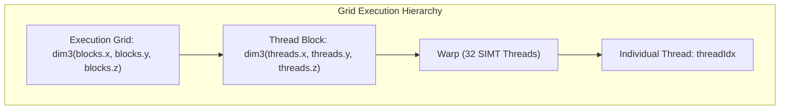
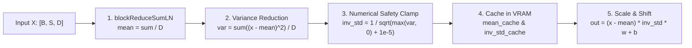
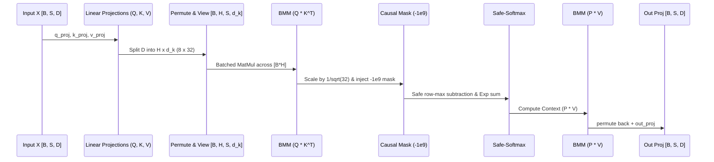

# Transformer Blocks & CUDA Kernels
**Project:** Pure C++/CUDA Transformer Engine  
**Module:** Neural Network Layers & Device Compute Kernels  
**Key Sources:** `layers/bmm.cu`, `layers/layernorm.cu`, `layers/softmax.cu`, `layers/causal_mask.cu`, `layers/gelu.cu`, `layers/add.cu`, `layers/permute.cu`, `layers/modules.h`, `layers/encoder.cu`  

---

## 1. CUDA Thread & Block Indexing Math

Every neural network operator in the `layers/` directory executes as an explicitly configured grid of thread blocks mapped onto the GPU Streaming Multiprocessors (SMs).



### Coordinate Mapping Patterns in the Codebase

#### 1. Flat 1D Element-Wise Mapping
Used in `gelu.cu`, `scale.cu`, `embedding.cu`, and `causal_mask.cu`:
```cpp
int idx = blockIdx.x * blockDim.x + threadIdx.x;
if (idx < total_size) {
    // Process element at idx
}
```
- **Grid Configuration**:
  ```cpp
  int threads = 256;
  int blocks = (total_size + threads - 1) / threads;
  ```
- **Mathematical Bound**: Handles arbitrary `total_size` by calculating ceiling division `(total_size + 255) / 256` and branching on `if (idx < total_size)` to prevent out-of-bounds writes on non-multiple array lengths.

#### 2. Row-Independent Reduction Mapping (1D Grid of 1D Blocks)
Used in `layernorm.cu`, `softmax.cu`, and `loss.cu`:
```cpp
int row = blockIdx.x;
if (row >= rows) return;
int tid = threadIdx.x;
const float* in_row = in + row * cols;
```
- **Mapping Principle**: Exactly **one thread block** is assigned to each row of the matrix.
- **Thread Cooperation**: All threads in `blockIdx.x` collaborate via warp shuffles and shared memory to compute reductions (mean, variance, max, sum) across the columns of that single row.

#### 3. 2D Tiled Matrix Coordinates with Batch Stride (3D Grid of 2D Blocks)
Used in `bmm.cu`:
```cpp
int batch_idx = blockIdx.z;
int bx = blockIdx.x; // Block column coordinate
int by = blockIdx.y; // Block row coordinate
int tx = threadIdx.x;
int ty = threadIdx.y;
```
- **Mapping Principle**: `blockIdx.z` selects the batch index, while `(blockIdx.x, blockIdx.y)` tiles the 2D output matrix into $BM \times BN$ computational tiles.

---

### Hardware Reduction Primitives: Warp Shuffles & Shared Memory

Traditional parallel reductions require write-after-read synchronization in global memory. The engine instead utilizes register-level **Warp Shuffle Primitives** (`__shfl_down_sync`) and shared memory tree reductions.

```cpp
// layers/softmax.cu: Lines 10-20
__inline__ __device__ float warpReduceMax(float val) {
    for (int offset = 16; offset > 0; offset /= 2)
        val = max(val, __shfl_down_sync(0xffffffff, val, offset));
    return val;
}

__inline__ __device__ float warpReduceSum(float val) {
    for (int offset = 16; offset > 0; offset /= 2)
        val += __shfl_down_sync(0xffffffff, val, offset);
    return val;
}
```

```mermaid
flowchart TD
    subgraph Warp Level Reduction (32 Threads in Registers)
        T0["Thread 0"] <-->|__shfl_down_sync 16| T16["Thread 16"]
        T0 <-->|__shfl_down_sync 8| T8["Thread 8"]
        T0 <-->|__shfl_down_sync 4| T4["Thread 4"]
        T0 <-->|__shfl_down_sync 2| T2["Thread 2"]
        T0 <-->|__shfl_down_sync 1| T1["Thread 1"]
        T0 -->|Warp Result in Thread 0| SMEM["Shared Memory shared[wid]"]
    end
    subgraph Block Level Reduction (Max 32 Warps)
        SMEM --> W0["Warp 0 reads shared[0..31]"]
        W0 --> FINAL["Final Block Reduction"]
    end
```

#### Why `__shfl_down_sync` Outperforms Shared Memory:
1. **Zero Memory Footprint**: Data exchanges occur directly across the GPU register files within the warp without reading or writing shared memory.
2. **Single-Cycle Latency**: Reduces 32 values into a single register in exactly 5 assembly instructions ($\log_2 32 = 5$).
3. **Two-Stage Block Reduction**:
   - Stage 1: Each 32-thread warp executes `warpReduceMax(val)`. Lane 0 of each warp writes its local maximum to `shared[wid]`.
   - Stage 2: `__syncthreads()` synchronizes the block. Warp 0 loads the per-warp values from shared memory and executes a final `warpReduceMax(val)`. The block-wide result is broadcast to all threads.

---

## 2. Batched Matrix Multiplication (`layers/bmm.cu`)

Batched Matrix Multiplication (BMM) is the primary computational bottleneck of the transformer architecture, powering linear projections ($Q, K, V, \text{Out}, \text{MLP}_1, \text{MLP}_2$) and attention dot-products ($Q K^T$ and $P V$).

### Tiled Shared Memory Architecture

```mermaid
flowchart TD
    subgraph Global VRAM
        GA["Matrix A [M, K]"]
        GB["Matrix B [K, N] (or Transposed B [N, K])"]
    end

    subgraph Thread Block (64x64 Output Tile)
        SA["s_A Shared Memory<br/>(64 x 16 floats = 1024)"]
        SB["s_B Shared Memory<br/>(16 x 64 floats = 1024)"]
        REG["Register Tile r_C[TM][TN]<br/>(4 x 4 = 16 floats per thread)"]
    end

    GA -->|Vectorized float4 Load| SA
    GB -->|Vectorized float4 Load| SB
    SA & SB -->|Inner Loop K-Accumulation| REG
    REG -->|Final Write| GC["Matrix C Output [M, N]"]
```

#### Tiling Parameters:
```cpp
// layers/bmm.cu: Lines 5-9
#define BM 64    // Block tile size in M dimension
#define BN 64    // Block tile size in N dimension
#define BK 16    // Block tile size in K dimension
#define TM 4     // Register tile per thread in M dimension
#define TN 4     // Register tile per thread in N dimension
```

1. **Thread Block Topology**: Configured as `dim3 threads(16, 16)` = 256 threads per block.
2. **Computational Work per Thread**: Each thread calculates a $4 \times 4 = 16$ tile of output elements ($r_C[4][4]$).
3. **Total Block Output**: $16 \times 4 = 64$ rows by $16 \times 4 = 64$ columns = 4,096 matrix elements computed per thread block.
4. **Vectorized Global Memory Loads (`float4`)**:
   ```cpp
   float4 vec_A = reinterpret_cast<const float4*>(&batch_A[global_a_row * K + global_a_col])[0];
   s_A[load_a_row * BK + load_a_col + 0] = vec_A.x;
   s_A[load_a_row * BK + load_a_col + 1] = vec_A.y;
   s_A[load_a_row * BK + load_a_col + 2] = vec_A.z;
   s_A[load_a_row * BK + load_a_col + 3] = vec_A.w;
   ```
   Instead of dispatching four 32-bit load instructions, the compiler emits a single 128-bit `LDG.E.128` instruction. This saturates the memory controller's 128-byte cache line requests and minimizes instruction issue overhead.

---

### The Transposed B Kernel (`bmm_forward_transB_kernel`)

In linear projections, the weights are stored in standard row-major layout as $W \in \mathbb{R}^{\text{out} \times \text{in}}$. Computing $X W^T$ requires multiplying $A \in [M, K]$ by $B^T \in [K, N]$ where $B$ is physically stored as $[N, K]$.

```cpp
// layers/bmm.cu: Lines 166-183
int global_b_row = bx * BN + load_b_row; // Row in B (N dimension)
int global_b_col = t * BK + load_b_col;  // Col in B (K dimension)

if (global_b_row < N && global_b_col < K) {
    float4 vec_B = reinterpret_cast<const float4*>(&batch_B[global_b_row * K + global_b_col])[0];
    // Write transposed directly into shared memory s_B
    s_B[(load_b_col + 0) * BN + load_b_row] = vec_B.x;
    s_B[(load_b_col + 1) * BN + load_b_row] = vec_B.y;
    s_B[(load_b_col + 2) * BN + load_b_row] = vec_B.z;
    s_B[(load_b_col + 3) * BN + load_b_row] = vec_B.w;
}
```
By transposing the matrix during the shared memory write phase, the inner accumulation loop reads $s_B$ contiguously along columns with **zero bank conflicts**.

---

### The 2D Matrix Batch Stride Bug & VRAM Corruption Fix

The most subtle and catastrophic bug in the original engine occurred in `bmm.cu`:

```cpp
// BROKEN IMPLEMENTATION: layers/bmm.cu: Line 317
int b_stride_B = (ndimB >= 3) ? B->strides[ndimB - 3] : B_rows * B_cols;
```

#### The Failure Mechanism:
When multiplying 3D batch activations $A \in [B=16, S=128, D=256]$ by a 2D weight matrix $W \in [D=256, D=256]$ (e.g. in Linear layers):
- `ndimA = 3`, `ndimB = 2`.
- Since `ndimB < 3`, `b_stride_B` evaluated to $B_{\text{rows}} \times B_{\text{cols}} = 256 \times 256 = 65,536$.
- In the forward pass:
  ```cpp
  const float* batch_B = B + batch_idx * batch_stride_B;
  ```
  For batch index `batch_idx = 1`, `batch_B` read starting at offset $+65,536$ (past the buffer). For `batch_idx = 15`, it read starting at offset $+983,040$—nearly 4 MB past the allocated memory of `B`!
- In the backward pass:
  ```cpp
  atomicAdd(&dB[batch_idx * b_stride_B + row * limit2 + col], sum);
  ```
  Batches $1 \dots 15$ performed atomic gradient additions into unallocated VRAM, silently corrupting neighboring tensors, activations, and AdamW optimizer buffers.
- Consequence: Layer 0 query projections received virtually no gradients ($10^{-5}$ norm starvation) and the network randomly detonated into NaNs.

#### The Structural Patch:
```cpp
// layers/bmm.cu: Line 317 (PATCHED)
int b_stride_A = (ndimA >= 3) ? A->strides[ndimA - 3] : M * K;
int b_stride_B = (ndimB >= 3) ? B->strides[ndimB - 3] : 0; // ZERO STRIDE FOR 2D WEIGHTS
int b_stride_C = M * N;
```
When `ndimB < 3`, `b_stride_B` is strictly `0`. Every batch $0 \dots 15$ reads the exact same weight matrix $B$, and during backpropagation, gradients from all 16 batches atomically accumulate into the single weight gradient buffer $\nabla B$.

---

## 3. Pre-LN Layer Normalization (`layers/layernorm.cu`)

In modern Transformers, Layer Normalization is placed on the input paths of each residual sub-layer (Pre-LN):
$$y = \text{LayerNorm}(x) \cdot \gamma + \beta = \frac{x - \mu}{\sqrt{\sigma^2 + \epsilon}} \cdot \gamma + \beta$$



### Forward Kernel & Numerical Armor

```cpp
// layers/layernorm.cu: Lines 58-65
__shared__ float s_inv_std;
if (tid == 0) {
    float var = var_sum / cols;
    // Hardened safety clamp: Prevents sqrt(negative) or 1/0
    s_inv_std = 1.0f / sqrtf(fmaxf(var, 0.0f) + 1e-5f);
    inv_std_cache[row] = s_inv_std; // Cache for backward pass
}
__syncthreads();
float inv_std = s_inv_std;
```

1. **Warp-Accelerated Reductions**: Two reduction passes compute the row mean and variance using `blockReduceSumLN`.
2. **Hardware Protection Against $\sqrt{-\delta}$**: Floating-point rounding errors during $\sum (x - \mu)^2$ can occasionally yield infinitesimal negative numbers (e.g. $-10^{-12}$). Computing $\sqrt{-10^{-12}}$ generates an immediate IEEE 754 NaN. The kernel clamps the variance using `fmaxf(var, 0.0f)` before adding $\epsilon = 10^{-5}$.
3. **VRAM Activation Caching**: Both `mean` and `inv_std` are written to `mean_cache[row]` and `inv_std_cache[row]`. This saves re-computing statistical reductions during the backward pass.

---

### Layer Normalization Backward Calculus

Let $x \in \mathbb{R}^D$ be a row vector, $\mu = \frac{1}{D}\sum_i x_i$, $\sigma^2 = \frac{1}{D}\sum_i (x_i - \mu)^2$, $\hat{x}_i = \frac{x_i - \mu}{\sqrt{\sigma^2 + \epsilon}}$, and $y_i = \gamma_i \hat{x}_i + \beta_i$.

Given incoming upstream gradient $\frac{\partial \mathcal{L}}{\partial y_i}$:
1. **Parameter Gradients**:
   $$\frac{\partial \mathcal{L}}{\partial \gamma_i} = \sum_{\text{rows}} \frac{\partial \mathcal{L}}{\partial y_i} \hat{x}_i, \quad \frac{\partial \mathcal{L}}{\partial \beta_i} = \sum_{\text{rows}} \frac{\partial \mathcal{L}}{\partial y_i}$$
2. **Input Gradients**:
   Let $d\hat{x}_i = \frac{\partial \mathcal{L}}{\partial y_i} \cdot \gamma_i$. Applying the multivariate chain rule:
   $$\frac{\partial \mathcal{L}}{\partial x_i} = \frac{1}{\sqrt{\sigma^2 + \epsilon}} \left( d\hat{x}_i - \frac{1}{D} \sum_{k=1}^D d\hat{x}_k - \frac{\hat{x}_i}{D} \sum_{k=1}^D d\hat{x}_k \hat{x}_k \right)$$

```cpp
// layers/layernorm.cu: Lines 130-138
float inv_N = 1.0f / cols;
for (int i = tid; i < cols; i += blockDim.x) {
    float w = weight ? weight[i] : 1.0f;
    float dx_hat = d_out_row[i] * w;
    float x_hat = (in_row[i] - mean) * inv_std;
    
    float dx = inv_std * (dx_hat - inv_N * (s_dx_hat_sum + x_hat * s_dx_hat_x_sum));
    atomicAdd(&d_in_row[i], dx);
}
```

The backward kernel evaluates the inner sums `s_dx_hat_sum` and `s_dx_hat_x_sum` in a single cooperative block sweep, then writes the exact analytical gradient back to `d_in_row` without intermediate memory allocations.

---

## 4. Multi-Head Causal Attention (`layers/modules.h` & `layers/softmax.cu`)

Multi-Head Attention allows the model to jointly attend to information from different representation subspaces at different positions.



### Complete Forward Attention Pipeline

```cpp
// layers/modules.h: Lines 86-120
std::shared_ptr<Tensor> MultiHeadAttention::forward(std::shared_ptr<Tensor> x) {
    int B = x->shape[0];
    int Seq = x->shape[1];
    
    // 1. Linear Projections: [B, S, D] -> [B, S, D]
    auto q = q_proj->forward(x);
    auto k = k_proj->forward(x);
    auto v = v_proj->forward(x);
    
    // 2. Head Splitting: [B, S, D] -> [B, S, H, d_k]
    q = view(q, {B, Seq, num_heads, head_dim});
    k = view(k, {B, Seq, num_heads, head_dim});
    v = view(v, {B, Seq, num_heads, head_dim});
    
    // 3. Transpose for Batched Attention: [B, H, S, d_k]
    q = permute(q, {0, 2, 1, 3});
    k = permute(k, {0, 2, 1, 3});
    v = permute(v, {0, 2, 1, 3});
    
    // 4. Dot-Product Scores: Q * K^T -> [B, H, S, S]
    auto scores = bmm(q, k, true); 
    
    // 5. Variance Scaling: Scores / sqrt(d_k)
    scores = scale(scores, 1.0f / std::sqrt((float)head_dim));
    
    // 6. Causal Masking: Mask future tokens with -1e9
    scores = apply_causal_mask(scores);
    
    // 7. Numerically Stable Safe-Softmax
    auto probs = softmax(scores);
    
    // 8. Context Aggregation: P * V -> [B, H, S, d_k]
    auto context = bmm(probs, v, false);
    
    // 9. Reassemble Heads: [B, S, D]
    context = permute(context, {0, 2, 1, 3});
    context = view(context, {B, Seq, embed_dim});
    
    // 10. Output Projection: [B, S, D] -> [B, S, D]
    return out_proj->forward(context);
}
```

---

### Numerically Stable Safe-Softmax (`layers/softmax.cu`)

In standard Softmax, $P_i = \frac{\exp(z_i)}{\sum_j \exp(z_j)}$. 
When attention scores exceed $88.7f$, $\expf(z_i)$ overflows single-precision floating point to $+\infty$, producing $\frac{\infty}{\infty} = \text{NaN}$.

#### The Safe-Softmax Transformation:
Subtracting the maximum unmasked score preserves mathematical equality while preventing overflow:
$$P_i = \frac{\exp(z_i - z_{\max})}{\sum_j \exp(z_j - z_{\max})}, \quad \text{where } z_{\max} = \max_{j, \text{ unmasked}} z_j$$
Because $z_i - z_{\max} \le 0.0f$, $\expf(z_i - z_{\max}) \in (0.0, 1.0]$, making overflow physically impossible.

```cpp
// layers/softmax.cu: Lines 57-106
// 1. Find Max strictly among unmasked scores (> -1e8)
float max_val = -FLT_MAX;
for (int i = tid; i < cols; i += blockDim.x) {
    float val = in_row[i];
    if (val > -1e8f && !isnan(val)) {
        max_val = fmaxf(max_val, val);
    }
}
max_val = blockReduceMax(max_val, shared_mem);
...
// 2. Sum of Exponentials
float sum_exp = 0.0f;
for (int i = tid; i < cols; i += blockDim.x) {
    float val = in_row[i];
    if (val > -1e8f && !isnan(val)) {
        float safe_score = val - max_val;
        sum_exp += expf(safe_score);
    }
}
sum_exp = blockReduceSum(sum_exp, shared_mem);
...
// 3. Compute Probabilities & Clamp Masked Elements to Strictly 0.0f
for (int i = tid; i < cols; i += blockDim.x) {
    float val = in_row[i];
    if (val > -1e8f && !isnan(val)) {
        float safe_score = val - max_val;
        out_row[i] = expf(safe_score) / sum_exp;
    } else {
        out_row[i] = 0.0f; // Causal future tokens receive strictly 0 probability
    }
}
```

---

### Softmax Jacobian Backward Kernel (`layers/softmax.cu`)

The derivative of the Softmax distribution with respect to input logits is:
$$\frac{\partial \mathcal{L}}{\partial z_i} = P_i \left( \frac{\partial \mathcal{L}}{\partial P_i} - \sum_{k=1}^S P_k \frac{\partial \mathcal{L}}{\partial P_k} \right)$$

```cpp
// layers/softmax.cu: Lines 123-146
// 1. Dot product: sum(P * dOut)
float sum_val = 0.0f;
for (int i = tid; i < cols; i += blockDim.x) {
    float p = out_row[i];
    if (p > 0.0f) {
        sum_val += p * d_out_row[i];
    }
}
sum_val = blockReduceSum(sum_val, shared_mem);
...
// 2. Compute local gradients: P * (dOut - sum)
for (int i = tid; i < cols; i += blockDim.x) {
    float p = out_row[i];
    if (p > 0.0f) {
        float grad = p * (d_out_row[i] - sum_val);
        atomicAdd(&d_in_row[i], grad);
    }
}
```
If a token was causally masked ($P_i = 0.0f$), its backpropagated gradient evaluates strictly to $0.0f$, preserving the autoregressive mask during backpropagation.

---

## 5. Feed-Forward Network (MLP) & Residual Highways

Following self-attention, activations pass through a position-wise Feed-Forward Network:
$$\text{FFN}(x) = \text{GELU}(x W_1^T + b_1) W_2^T + b_2$$
where $W_1 \in \mathbb{R}^{4D \times D}$ ($256 \to 1024$) and $W_2 \in \mathbb{R}^{D \times 4D}$ ($1024 \to 256$).

### GELU Activation & Analytical Derivative (`layers/gelu.cu`)

The engine implements the high-speed Hendrycks tanh approximation:
$$\text{GELU}(x) = 0.5x \left( 1 + \tanh\left( \sqrt{\frac{2}{\pi}} (x + 0.044715 x^3) \right) \right)$$

```cpp
// layers/gelu.cu: Lines 5-23
#define GELU_COEF_A 0.7978845608f  // sqrt(2/pi)
#define GELU_COEF_B 0.0356774081f  // sqrt(2/pi) * 0.044715

__device__ float gelu_fwd(float x) {
    float cube = x * x * x;
    return 0.5f * x * (1.0f + tanhf(GELU_COEF_A * x + GELU_COEF_B * cube));
}

__device__ float gelu_bwd(float x) {
    float x_sq = x * x;
    float cube = x_sq * x;
    float inner = GELU_COEF_A * x + GELU_COEF_B * cube;
    float tanh_inner = tanhf(inner);
    float sech_sq = 1.0f - tanh_inner * tanh_inner;
    
    float left = 0.5f * (1.0f + tanh_inner);
    float right = 0.5f * x * sech_sq * (GELU_COEF_A + 3.0f * GELU_COEF_B * x_sq);
    return left + right;
}
```

The backward kernel multiplies the upstream gradient by `gelu_bwd(x)` and accumulates into the gradient buffer via `atomicAdd`.

---

### The Residual Highway Gradient Routing (`layers/add.cu`)

Residual skip connections are the mathematical foundation that allows training deep networks without gradient decay:
$$x_{l+1} = x_l + F(x_l)$$

When the autograd engine differentiates `add(A, B)`:
$$\frac{\partial \mathcal{L}}{\partial x_l} = \frac{\partial \mathcal{L}}{\partial x_{l+1}} \cdot \frac{\partial (x_l + F(x_l))}{\partial x_l} = \frac{\partial \mathcal{L}}{\partial x_{l+1}} + \frac{\partial \mathcal{L}}{\partial x_{l+1}} \cdot \frac{\partial F(x_l)}{\partial x_l}$$

```cpp
// layers/add.cu: Lines 44-55
__global__ void broadcast_add_backward_kernel(
    float* grad_a, float* grad_b, const float* grad_out, 
    BroadcastInfo info, int total_size, bool req_a, bool req_b) 
{
    int idx = blockIdx.x * blockDim.x + threadIdx.x;
    if (idx < total_size) {
        int idx_a, idx_b;
        get_indices(idx, info, idx_a, idx_b);
        float g = grad_out[idx];
        
        if (req_a) atomicAdd(&grad_a[idx_a], g);
        if (req_b) atomicAdd(&grad_b[idx_b], g);
    }
}
```

The incoming gradient $g$ is added **equally and without attenuation** directly to the identity branch (`grad_a`) and the sub-layer transformation branch (`grad_b`). This creates an uninterrupted gradient highway back to Layer 0.
