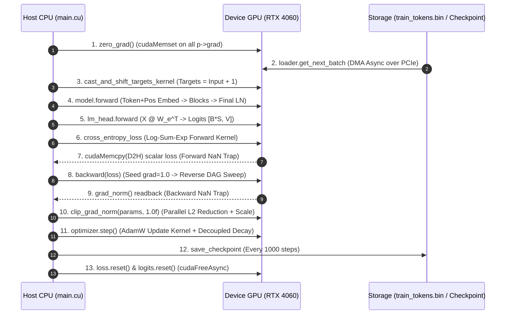
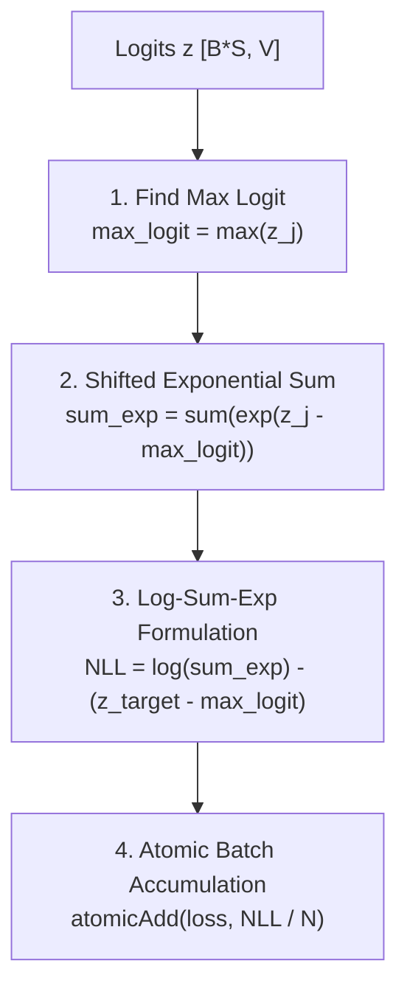
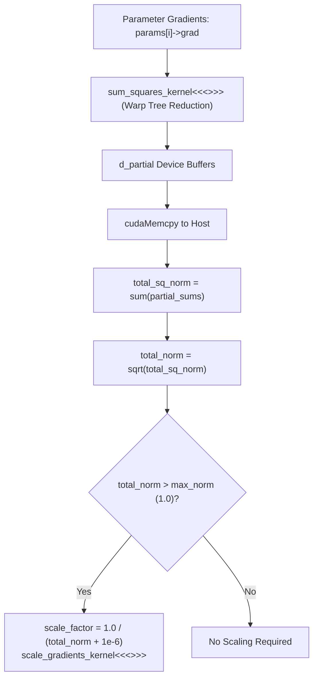
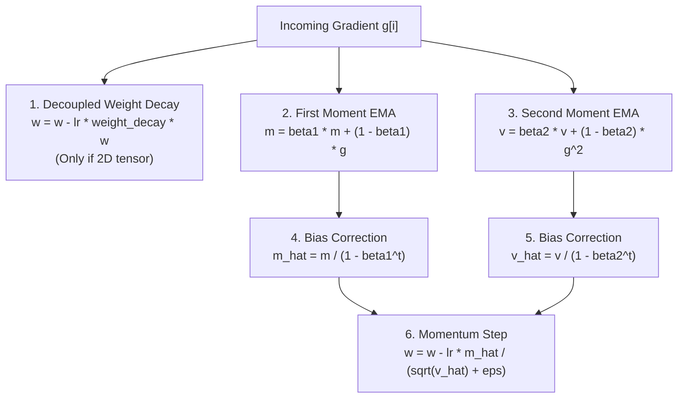
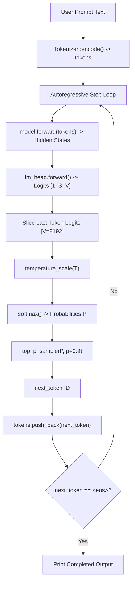

# Training Lifecycle, Loss & Optimization
**Project:** Pure C++/CUDA Transformer Engine  
**Module:** Training Orchestration, Loss Formulation, Gradient Clipping & AdamW Optimizer  
**Key Sources:** `main.cu`, `training/loss.cu`, `training/loss.h`, `training/clip_grad.cu`, `training/optimizer.cu`, `training/checkpoint.cpp`, `inference/inference.cu`, `inference/sampling.cu`  

---

## 1. The Master Loop Execution Timeline (`main.cu`)

Training is orchestrated synchronously by the CPU while all heavy numerical tensor transformations execute asynchronously on the GPU.



---

### Step-by-Step Chronological Code Walkthrough

```cpp
// main.cu: Lines 126-188
for (int i = 1; i <= steps; ++i) {
    // 1. Explicitly zero gradients before forward pass
    for (auto& p : params) {
        if (p->grad) {
            cudaMemset(p->grad.get(), 0, p->total_size * sizeof(float));
        }
    }

    // 2. Fetch memory-mapped batch via DMA PCIe transfer
    auto input_ids = loader.get_next_batch(B, S);

    // 3. Target shifting kernel
    int threads = 256;
    int blocks = (B * S + threads - 1) / threads;
    cast_and_shift_targets_kernel<<<blocks, threads>>>(input_ids->data.get(), d_targets, B, S);

    // 4. Forward model pass
    auto encoded = model.forward(input_ids);
    encoded->shape = {B * S, D};
    
    // 5. Linear LM Head projection to vocabulary logits
    auto logits = lm_head->forward(encoded);

    // 6. Fused Cross-Entropy Loss
    auto loss = cross_entropy_loss(logits, d_targets);

    // 7. Forward NaN Validation Trap
    float h_loss_val = 0.0f;
    cudaMemcpy(&h_loss_val, loss->data.get(), sizeof(float), cudaMemcpyDeviceToHost);
    if (std::isnan(h_loss_val) || std::isinf(h_loss_val)) {
        printf("[FATAL] Forward NaN/Inf detected at step %d: loss = %f\n", i, h_loss_val);
        exit(1);
    }

    // 8. Backward autograd traversal
    backward(loss);

    // 9. Backward NaN Validation Trap
    float lm_grad_norm = lm_head->weight->grad_norm();
    float l0_q_grad_norm = model.blocks[0]->mhsa.q_proj->weight->grad_norm();
    if (std::isnan(lm_grad_norm) || std::isinf(lm_grad_norm) ||
        std::isnan(l0_q_grad_norm) || std::isinf(l0_q_grad_norm)) {
        printf("[FATAL] Backward NaN/Inf detected at step %d: LM Head grad = %f, L0 Q grad = %f\n", i, lm_grad_norm, l0_q_grad_norm);
        exit(1);
    }

    // 10. Global gradient clipping (max_norm = 1.0f)
    clip_grad_norm(params, 1.0f);

    // 11. Optimization step
    optimizer.step();

    // 12. Checkpoint persistence
    if (i % 1000 == 0) {
        cudaDeviceSynchronize();
        save_checkpoint("model_ckpt.bin", model, optimizer, tokenizer);
        std::cout << "--> Checkpoint saved at step " << i << std::endl;
    }

    // 13. Computational graph destruction (Frees host and device allocations)
    loss.reset();
    logits.reset();
    encoded.reset();
    input_ids.reset();
}
```

---

## 2. Weight Tying & Deduplicated Parameter Registration

In the GPT architecture, the input token embedding lookup matrix and the output vocabulary projection matrix share identical shapes: $V \times D$ ($8,192 \times 256$).

### 1. Weight Tying Mechanism
```cpp
// main.cu: Lines 108-109
std::shared_ptr<Linear> lm_head = std::make_shared<Linear>(D, V, false);
lm_head->weight = model.token_embed.weight;
```
1. `lm_head` is instantiated without a bias (`has_bias = false`).
2. Its `weight` shared pointer is reassigned directly to `model.token_embed.weight`.
3. **Benefits**:
   - Saves $8,192 \times 256 = 2,097,152$ FP32 parameters ($\approx 8.4$ MB VRAM).
   - Forces dual semantic alignment: words that have similar input vector representations are compelled to produce similar output generation probabilities.

---

### 2. The Optimizer Double-Registration Hazard
When backpropagation finishes:
- `token_embed.forward` has accumulated gradients into `token_embed.weight->grad` via `embedding_bwd_kernel_int`.
- `lm_head.forward` has accumulated gradients into `lm_head->weight->grad` via `bmm_backward_B_kernel`.
- Because both share the same `grad` pointer, the gradients are already correctly summed together via `atomicAdd`.

**The Danger**: If `collect_params()` blindly registers every sub-layer's weight pointers:
```cpp
// DANGEROUS BUG:
params.push_back(model.token_embed.weight);
...
params.push_back(lm_head->weight); // SAME DEVICE POINTER!
```
The optimizer's `params` list would contain the exact same physical memory address twice. During `optimizer.step()`:
- `adamw_kernel` would execute twice on the same weight memory.
- Decoupled weight decay would be applied **twice** per step ($2 \times \lambda$).
- Momentum buffers $m$ and $v$ would be double-stepped, destabilizing the optimizer.

#### The Structural Resolution: `std::unordered_set<void*>` Deduplication
```cpp
// main.cu: Lines 22-31
std::vector<std::shared_ptr<Tensor>> collect_params(TransformerEncoder& model) {
    std::vector<std::shared_ptr<Tensor>> params;
    std::unordered_set<void*> seen;

    auto add_param = [&](std::shared_ptr<Tensor> p) {
        if (p && seen.find(p->data.get()) == seen.end()) {
            seen.insert(p->data.get());
            params.push_back(p);
        }
    };
    ...
```
By hashing the raw device pointer address `p->data.get()`, shared parameters are registered **strictly once**, eliminating write-after-write optimizer hazards.

---

## 3. Log-Sum-Exp Cross-Entropy Loss (`training/loss.cu`)

Cross-entropy loss measures the divergence between the predicted probability distribution and the true target token.

$$\mathcal{L} = -\frac{1}{N} \sum_{i=1}^N \log P(y_i \mid x_i)$$
where $N = B \times S = 16 \times 128 = 2,048$ tokens, and $P(y_i) = \frac{\exp(z_{y_i})}{\sum_{j=1}^V \exp(z_j)}$.

---

### The Log-Sum-Exp Mathematical Formulation

Expanding the natural logarithm of the softmax probability:
$$\log P(y_i) = \log\left(\frac{\exp(z_{y_i})}{\sum_{j=1}^V \exp(z_j)}\right) = z_{y_i} - \log\left(\sum_{j=1}^V \exp(z_j)\right)$$
To avoid exponential overflow, we factor out the row maximum $z_{\max} = \max_j z_j$:
$$\log\left(\sum_{j=1}^V \exp(z_j)\right) = z_{\max} + \log\left(\sum_{j=1}^V \exp(z_j - z_{\max})\right)$$
Substituting this into the Negative Log-Likelihood:
$$\text{NLL}_i = -\log P(y_i) = \log\left(\sum_{j=1}^V \exp(z_j - z_{\max})\right) - (z_{y_i} - z_{\max})$$



---

### Why the Naive Formula Causes IEEE 754 Underflow Collapses

In early iterations, the forward pass computed loss naively:
```cpp
// BROKEN IMPLEMENTATION:
float p_target = expf(row_logits[target] - max_logit) / sum_exp;
float nll = -logf(p_target);
```
#### The Fatal Chain of Events:
1. When the model is untrained, target tokens occasionally receive strongly negative logits relative to the maximum score:
   $$z_{\text{target}} - z_{\max} < -88.02969f$$
2. In single-precision IEEE 754 floating point:
   $$\expf(x < -88.02969f) = 0.000000f \quad (\text{Complete Subnormal Underflow})$$
3. Consequently:
   $$p_{\text{target}} = \frac{0.0f}{\text{sum\_exp}} = 0.0f$$
4. Evaluating the logarithm:
   $$\text{nll} = -\logf(0.0f) = -(-\infty) = +\infty$$
5. `atomicAdd(loss, inf)` instantly detonates the loss into `+inf` or `NaN`, triggering the fatal trap.

#### The Log-Sum-Exp Armor:
```cpp
// training/loss.cu: Lines 55-60
if (threadIdx.x == 0) {
    float target_logit = (target >= 0 && target < vocab_size) ? row_logits[target] : (max_logit - 20.0f);
    // NLL = log(sum_exp) - (target_logit - max_logit)
    // Strictly prevents exp underflow to 0 and log(0) -> -inf
    float nll = logf(fmaxf(sum_exp, 1.0f)) - (target_logit - max_logit);
    atomicAdd(loss, nll / (float)num_rows);
}
```
Because the sum of exponentials always includes $\exp(z_{\max} - z_{\max}) = \exp(0) = 1.0$, $\text{sum\_exp} \ge 1.0$. Therefore, $\logf(\text{sum\_exp}) \ge 0.0$ is unconditionally finite, and no logarithm of zero can ever be evaluated.

---

### Backward Pass & The $\frac{1}{B \cdot S}$ Averaging Derivation

The gradient of cross-entropy loss with respect to logit $z_k$ is:
$$\frac{\partial \mathcal{L}}{\partial z_k} = \frac{1}{N} (P_k - y_k)$$
where $y_k = 1.0f$ if $k = \text{target}$, else $0.0f$.

```cpp
// training/loss.cu: Lines 114-120
for (int i = threadIdx.x; i < vocab_size; i += blockDim.x) {
    float p = expf(row_logits[i] - max_logit) / sum_exp;
    float target_val = (i == target) ? 1.0f : 0.0f;
    float grad = p - target_val;
    atomicAdd(&row_grad[i], (grad / (float)num_rows) * l_grad);
}
```

#### Why Dividing by `num_rows` ($B \cdot S$) is Critical:
If the $\frac{1}{N}$ division is omitted from the kernel:
- Gradients arriving at the LM Head are $2,048\times$ larger than they should be.
- The global gradient norm explodes to thousands ($>2,500.0f$).
- Gradient clipping caps the norm at $1.0f$, scaling all gradients down by $\frac{1}{2500}$.
- This starves the bottom layers (Layer 0 query gradients drop to $10^{-5}$), halting learning in early representations while LM Head weights churn chaotically.

---

## 4. Global Gradient Norm Clipping (`training/clip_grad.cu`)

To prevent gradient explosions during training, the engine enforces an upper bound on the global $L_2$ norm of all network parameters:

$$G = \sqrt{\sum_{p \in \text{params}} \sum_{i=1}^{\text{size}(p)} g_{p, i}^2}$$
$$\text{If } G > \text{max\_norm}: \quad g_{p, i} \leftarrow g_{p, i} \cdot \frac{\text{max\_norm}}{G + 10^{-6}}$$



### CUDA Reduction & Scaling Implementation

```cpp
// training/clip_grad.cu: Lines 6-29
__global__ void sum_squares_kernel(const float* __restrict__ grad, float* __restrict__ partial_sums, int size) {
    extern __shared__ float sdata[];
    int tid = threadIdx.x;
    int i = blockIdx.x * blockDim.x + threadIdx.x;
    
    float sum = 0.0f;
    if (i < size) {
        float g = grad[i];
        sum = g * g;
    }
    sdata[tid] = sum;
    __syncthreads();
    
    // In-shared-memory tree reduction
    for (int s = blockDim.x / 2; s > 0; s >>= 1) {
        if (tid < s) {
            sdata[tid] += sdata[tid + s];
        }
        __syncthreads();
    }
    
    if (tid == 0) {
        partial_sums[blockIdx.x] = sdata[0];
    }
}
```

1. **Parallel Sum of Squares**: Each thread squares its gradient element and participates in a shared memory tree reduction.
2. **Partial Sum Host Aggregation**: Block-level partial sums are transferred to host memory and summed across all tensors to yield `total_sq_norm`.
3. **In-Place Gradient Scaling**:
   ```cpp
   // training/clip_grad.cu: Lines 31-36
   __global__ void scale_gradients_kernel(float* __restrict__ grad, float scale, int size) {
       int i = blockIdx.x * blockDim.x + threadIdx.x;
       if (i < size) {
           grad[i] *= scale;
       }
   }
   ```
   If `total_norm > max_norm`, `scale_gradients_kernel` scales every parameter tensor by `scale_factor = max_norm / (total_norm + 1e-6f)`.

---

## 5. Decoupled AdamW Optimizer (`training/optimizer.cu`)

The engine implements **AdamW** (Loshchilov & Hutter, 2017) with true decoupled weight decay.



### The AdamW Update Kernel

```cpp
// training/optimizer.cu: Lines 8-35
__global__ void adamw_kernel(
    float* w, const float* g, float* m, float* v, 
    float lr, float beta1, float beta2, float eps, float weight_decay, int t, int size) 
{
    int idx = blockIdx.x * blockDim.x + threadIdx.x;
    if (idx >= size) return;

    float weight = w[idx];
    float grad = g[idx];

    // 1. In-place decoupled weight decay
    weight = weight - lr * weight_decay * weight;

    // 2. Moving averages of gradient and squared gradient
    float m_t = beta1 * m[idx] + (1.0f - beta1) * grad;
    float v_t = beta2 * v[idx] + (1.0f - beta2) * grad * grad;

    m[idx] = m_t;
    v[idx] = v_t;

    // 3. Bias correction for initial steps
    float m_hat = m_t / (1.0f - powf(beta1, t));
    float v_hat = fmaxf(v_t, 0.0f) / (1.0f - powf(beta2, t));

    // 4. Weight update with safe epsilon addition
    float weight_update = lr * m_hat / (sqrtf(fmaxf(v_hat, 0.0f)) + eps);
    w[idx] = weight - weight_update;
}
```

#### Why Decoupled Weight Decay is Restricted to 2D Tensors:
```cpp
// training/optimizer.cu: Line 77
float current_wd = (p->shape.size() >= 2) ? weight_decay : 0.0f;
```
- **2D Tensors (`shape.size() >= 2`)**: Projection matrices ($W_q, W_k, W_v, W_{\text{out}}, W_{\text{mlp1}}, W_{\text{mlp2}}, W_{\text{embed}}$). Decoupled weight decay exerts an $L_2$ shrinkage pressure, preventing logit drift and controlling weight Frobenius norms.
- **1D Tensors (`shape.size() == 1`)**: Biases ($b$) and LayerNorm scale parameters ($\gamma$). Decaying $\gamma$ toward zero causes layer collapse, while decaying biases interferes with shifting baseline distributions. Hence, weight decay is strictly disabled for 1D parameters.

---

## 6. Text Generation & Autoregressive Sampling (`inference/`)

During chat and evaluation modes (`--chat`), the trained model generates text autoregressively token-by-token.



### 1. Temperature Scaling (`inference/sampling.cu`)
Dividing logits by temperature $T > 0$ alters distribution entropy:
$$z_i' = \frac{z_i}{T}$$
- $T \to 0$ (e.g. $0.2$): Sharpened distribution, greedy deterministic decoding.
- $T = 1.0$: Standard categorical distribution.
- $T > 1.0$ (e.g. $1.5$): Flattened distribution, higher randomness and lexical diversity.

### 2. Top-$p$ (Nucleus) Sampling Pipeline
Unconstrained sampling from the long tail of the vocabulary introduces incoherence. Top-$p$ sampling filters the candidate pool to the smallest set of tokens whose cumulative probability exceeds threshold $p$ (e.g. $p = 0.90$).

1. **Parallel Bitonic Sort (`bitonic_sort_step`)**:
   Pads the 8,192 vocabulary probabilities to the nearest power of 2 (8,192) and runs a multi-pass parallel Bitonic Sort kernel on the GPU, sorting `ProbIndex { float prob; int index; }` descending by probability in $O(\log^2 V)$ parallel time.
2. **Block Prefix Sum & Tail Masking (`block_prefix_sum_mask_kernel`)**:
   Computes an inclusive prefix sum scan across the sorted array. As soon as the cumulative distribution function exceeds $p$:
   ```cpp
   if (cdf > p && i > 0) {
       data[i].prob = 0.0f; // Zero out low-probability tail tokens
   }
   ```
3. **Random Projection Sample (`sample_kernel`)**:
   Generates a uniform scalar $r \sim \mathcal{U}(0, 1)$ on the host, projects it across the sum of unmasked probabilities, and identifies the selected token ID on the GPU.
